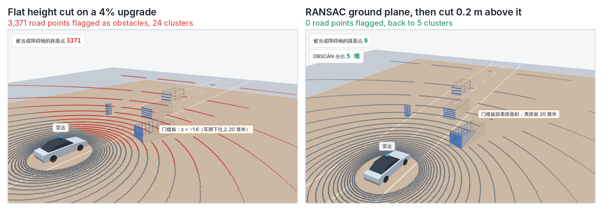
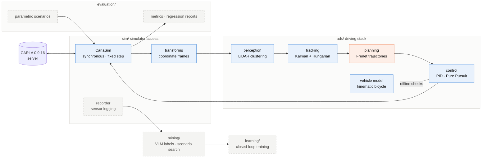

<div align="center">

# highway-sim-eval

**A driving stack I'm writing from scratch, run closed-loop in CARLA, with an evaluation layer on top.**

**English** · [简体中文](README.zh-CN.md)

[](https://www.python.org/)
[](https://carla.org/)
[](https://github.com/chasen2041maker/highway-sim-eval/actions/workflows/tests.yml)
[](#roadmap)
[](https://chasen2041maker.github.io/highway-sim-eval/)

[Interactive explainers](https://chasen2041maker.github.io/highway-sim-eval/) · [What I've found](#what-ive-found-so-far) · [Quick start](#quick-start) · [Roadmap](#roadmap)

</div>

---

<p align="center">
  
</p>

<p align="center">The same LiDAR frame on a 4% upgrade. Left: cutting the ground at a fixed height turns 3,371 road points into obstacles. Right: fit the road with RANSAC first, then cut 0.2 m above it. <a href="https://chasen2041maker.github.io/highway-sim-eval/a5_slope_ground.html">Step through it in 3D</a></p>

## Why I'm building this

I'm a backend and AI-agent engineer moving into autonomous driving. Reading about driving stacks didn't stick, so I'm writing one, one module at a time, and checking every module against the simulator's ground truth. The question I keep asking is the one simulation and evaluation teams ask every day: when a metric says the car drove well, can I trust that number?

The project is built to answer:

- Which driving stack is safer, smoother and faster on the same set of scenarios?
- When it fails, what happened just before?
- After a change, did it really get better, or were the scenarios just easier?
- Do open-loop metrics agree with how the car actually drives closed-loop?

## What I've found so far

- **The metric was wrong before the controller was.** Measuring lane error as "distance to the nearest waypoint" hid up to 0.25 m of error at 0.5 m waypoint spacing, so I replaced it with point-to-segment distance before tuning anything.
- **Integral windup is real in CARLA.** Holding 8 m/s, plain PI overshot to 9.46 m/s. Anti-windup brought the peak down to 8.27 m/s, and to 8.11 m/s after raising the integral gain to 0.5.
- **"Zero acceleration" is not "zero pedal".** Sending IDM's acceleration straight to the pedals left a 6.26 m gap behind a braking car, because the car slowed on its own whenever IDM asked for zero. Closing the loop with a speed PID gave 4.91 m, matching the pure model's 4.95 m.
- **The LiDAR box for the car ahead is 2.30 m short.** Only its rear face is visible, so a min/max box sits on the bumper. No clustering setting fixes it; the distance to the bumper (12.70 m) is still right.
- **A 4% slope breaks a fixed ground cut.** 3,371 road points from 5 m ahead became obstacles and detection precision fell to 0.04. A RANSAC ground plane fixed it (image above).
- **Differencing two LiDAR frames is a bad speedometer.** With ±0.2 m range noise at 10 Hz, the speed of the car ahead was off by up to 5.5 m/s. A constant-velocity Kalman filter on the same data stays within 0.35 m/s after the first second (error σ 1.36 → 0.09 m/s).
- **Losing a car for half a second should not rename it.** Tracking three cars through shuffled, noisy LiDAR boxes, keeping an unmatched track for up to 10 frames held all three IDs through a 0.5 s occlusion. Keeping it for only 3 frames dropped the hidden car at 2.3 s and gave it a new ID at 2.5 s, with its speed estimate starting again from zero. Waiting longer has a cost too: a one-frame guardrail false alarm lived on as a ghost track for a full second. Scored against ground truth, 10 frames vs 3: ID switches 0 vs 1, missed car-frames 0 vs 2, speed error 0.33 vs 0.44 m/s, but false-track frames 11 vs 4. No setting wins every number; the choice depends on which mistake is more dangerous.
- **A lane change that is only right on straight roads.** Planning the lane change in the Frenet frame (offset toward the road's left) and planning it by adding the offset to map y draw the same line on a straight road. In a 90° left curve, the y + d car ended 3.50 m from the left lane centre, back in its own lane, because by the end of the curve "+y" pointed straight ahead. The Frenet car ended 0.00 m from it. Lane change and curve also add up: 2.0 m/s² for the curve alone, 3.19 m/s² peak with the lane change on top.
- **CI caught me on day one.** The first GitHub Actions run failed because scikit-learn was missing from `requirements.txt`. It had only ever worked on my laptop.

## At a glance

| Module | What it does | Result | Status |
| --- | --- | --- | --- |
| Vehicle model | Kinematic bicycle model (rear-axle reference, steering limit) | Circle diameter matches 2L / tan δ | Done |
| Longitudinal control | PID speed control with anti-windup | In CARLA at 8 m/s, peak speed 9.46 → 8.11 m/s | Done, verified in CARLA |
| Lateral control | Pure Pursuit along CARLA lane waypoints | Look-ahead 2 / 5 / 10 m: max deviation 0.27 / 0.32 / 0.82 m | Done, verified in CARLA |
| Car following | IDM with a closing-speed term, executed through a reference speed and a PID loop | Hard braking ahead: minimum gap 4.91 m in CARLA vs 4.95 m in the model | Done; stop-and-hold in the model |
| Evaluation metric | Point-to-segment lateral error | Nearest-waypoint distance hid up to 0.25 m | Done |
| LiDAR perception | Ground removal (height cut, RANSAC on slopes), DBSCAN, boxes on a simulated 32-beam scan | Lead car box 2.30 m short (rear face only); slope: 3,371 → 0 false ground points | Done on the simulated LiDAR |
| Detection evaluation | Greedy one-to-one matching on center distance; recall, precision, center error | Recall 0.40 / 0.60 / 1.00 at nuScenes gates 0.5 / 2 / 4 m | Done |
| Tracking | Lead-car speed from LiDAR distances with a constant-velocity Kalman filter; three cars tracked through shuffled boxes with Hungarian matching (2 m gate) and track IDs; scored against ground truth (position / speed error, ID switches, missed, false tracks) | Max speed error 5.55 m/s (frame differencing) → 0.35 m/s (Kalman); `max_misses` 10 vs 3: ID switches 0 vs 1, false-track frames 11 vs 4 | Done (pure Python) |
| Lane change | MOBIL decision (safety + incentive); quintic (minimum-jerk) lateral profile d(t); Frenet (s, d) to map (x, y); followed with the bicycle model and Pure Pursuit | 3.5 m in 2 / 4 / 6 s: peak lateral acceleration 5.05 / 1.26 / 0.56 m/s²; in a 90° curve: Frenet path ends in the left lane, map y + d ends 3.50 m off | Done (pure Python) |

93 Python unit tests and 21 C++ tests (googletest), with expected values worked out by hand, run by GitHub Actions on every push.

## Architecture



Blue = done · orange = in progress · dashed grey = planned

## Quick start

**Requirements**: Python 3.10; CARLA 0.9.16 (server and Python client) and an NVIDIA GPU with 8 GB or more for the CARLA examples.

```powershell
git clone https://github.com/chasen2041maker/highway-sim-eval.git
cd highway-sim-eval
python -m pip install -r requirements.txt pytest   # pinned dependencies (the same set CI installs)
python -m pip install carla==0.9.16 matplotlib      # only for the CARLA examples and plots

python -m pytest -q        # unit tests: pure Python, no CARLA needed; GitHub Actions runs them on every push
```

**Running against CARLA**: start the server, then run an example from a second terminal.

```powershell
# terminal 1: in the CARLA install folder
.\CarlaUE4.exe -quality-level=Low -windowed -ResX=1280 -ResY=720

# terminal 2: in the project root
python -m examples.a2_client_demo
```

> On laptops with two GPUs add `-prefernvidia` so CARLA uses the discrete card. Run one CARLA instance at a time; a second one exits because port 2000 is taken.

## Usage

```python
import carla
from sim.carla_client import CarlaSim
from sim.transforms import carla_to_ours

with CarlaSim(dt_s=0.05) as sim:            # synchronous mode, 0.05 s per frame
    ego = sim.spawn_ego()                    # spawns the ego car; destroyed on exit
    for _ in range(60):
        ego.apply_control(carla.VehicleControl(throttle=0.5, steer=0.1))
        frame, sim_time_s = sim.tick()       # frame number + simulation time
        tf = ego.get_transform()
        x, y, heading = carla_to_ours(tf.location.x, tf.location.y, tf.rotation.yaw)

# leaving the with-block (even on an exception) destroys spawned actors and restores the server settings
```

## Experiment log

Every row comes from a script in `examples/`; the setup column says what was run.

<details>
<summary><b>Show all experiments (CARLA and pure Python)</b></summary>

<p align="center">
  
  
</p>

<p align="center">Both figures are generated by <code>python -m scripts.readme_figures</code> from the project's own model and controller.</p>

| Experiment | Setup | Result |
| --- | --- | --- |
| Bicycle model circles | 10 m/s, front-wheel angle 0.1 / 0.2 rad | Diameter 55.81 / 27.63 m, matching 2L / tan δ; doubling the speed keeps the diameter and halves the lap time |
| PID on a slope | Target 10 m/s, slope −0.5 m/s² | P only settles at 9.00 m/s (1 m/s steady-state error); PI converges to 10.00 m/s, peak 10.89 m/s |
| PID in CARLA (anti-windup) | Model 3, flat road, target 8 m/s, kp 1.0, throttle limit 1, 8 s | ki 0.2 without anti-windup: peak 9.46 m/s, 8.27 m/s at 8 s; with anti-windup: peak 8.27, 7.89 at 8 s; ki 0.5: peak 8.11, 7.99 at 8 s. Holding 8 m/s takes about 0.39 throttle |
| Pure Pursuit in CARLA (real lane) | Town10HD spawn 0; 80 m of lane centre line from map waypoints every 0.5 m (first branch at the junction, a left turn); target 6 m/s, 12 s; Ld = 2 / 5 / 10 m | Max distance from the centre line 0.27 / 0.32 / 0.82 m. Ld 10 starts turning earlier (front wheel 8.1° at 1 s vs 6.4° for Ld 2), turns more gently (max 11.0° vs 12.8°) and straightens later, cutting the corner by 0.82 m and returning to the line after about 5 s; no weaving with Ld 2 at 6 m/s. Steer vs wheel angle implies a Model 3 maximum wheel angle of about 70°. This metric was "distance to the nearest waypoint", which carries about 0.25 m of resolution error at 0.5 m spacing, so 0.27 and 0.32 can't be told apart; to be rerun with point-to-segment error |
| Pure Pursuit look-ahead | 40 m straight → 90° left turn of radius 20 m → 40 m straight; start 3 m off the path, 10 m/s; Ld = 2 / 5 / 15 m | Furthest overshoot on the straight 1.23 / 0.27 / 0 m, max lateral error in the bend 0.08 / 0.16 / 1.13 m: short look-ahead weaves, long look-ahead cuts corners. Explainer: `docs/a3_pure_pursuit_animation.html` |
| IDM car following, lead car brakes hard | Both cars 10 m/s, gap 25 m; lead brakes at −5 m/s² from 5 s to a stop; ego target 15 m/s, braking limit −8 m/s² | Gap term only: brakes noticeably only at 15 m, max deceleration 5.96 m/s², minimum gap 4.46 m; with the closing-speed term braking starts at 20 m, max 3.69 m/s², minimum gap 4.95 m; no collision in either. With a 0.5 s time headway: still no collision with the closing-speed term (minimum 3.50 m, max 6.69 m/s²); without it the car collides even at full 8 m/s² braking |
| IDM in CARLA, hard braking (open-loop pedals) | Same scenario: Town10HD spawn 80 (178 m of straight road, found with `examples/tool_find_straight.py`), two Model 3s; both scripted at 10 m/s for 1 s, then IDM takes over; the lead brakes at −5 m/s² via `set_target_velocity`; IDM acceleration goes straight to the pedals through `to_pedals` | No collision, minimum gap 6.26 / 6.28 m (two runs). IDM output matches hand calculation (7.0 s: −0.06 m/s²; +1.21 without the closing-speed term), but the car did not follow it: following at 10 m/s IDM asks for about +0.45 while actual acceleration ≈ 0 (the throttle needed to hold speed); while the lead stops IDM goes +0.24 → −0.06, brake pedal max 0.07, yet coasting off the throttle gives −2.7 m/s². The open-loop map from acceleration to pedals is biased: IDM's 0 is about 0.45 throttle, and 0 throttle is about −2 m/s². Being conservative here was luck. The single-frame extreme (IDM's peak braking demand) was −0.57 / −0.10 across two runs, so it is not a usable metric |
| IDM in CARLA, hard braking (inner speed loop) | Same scenario; IDM acceleration is integrated into a reference speed (`shadow += a·dt`) and a PID (kp 1.0, ki 0.5, u_max 1.0) tracks it and outputs the pedals; `CLOSED_LOOP` switches back to open loop | No collision, minimum gap 4.91 m, IDM peak braking demand −3.65 m/s², in line with the pure model (4.95 m, −3.69). While the lead stops, actual deceleration −0.37 → −3.32 follows IDM (−1.04 → −3.63) about 0.5 s late; following at 10 m/s the PID integral finds about 0.43 throttle on its own; brake pedal max 0.40 (0.07 open loop). Below 3 m/s near the stop, throttle 1.0 and brake 0.40 alternate and the car jerks (speed 0.42 ↔ 1.72); the single-frame extreme of −4.62 m/s² comes from this jerk, not the emergency braking (−3.32). Needs stop-and-hold logic |
| All three together: car following in a bend (pure model) | 40 m straight → 90° left turn of radius 20 m → straight, waypoints every 0.5 m; both cars 10 m/s, gap 25 m, the lead brakes at −5 m/s² to a stop inside the bend at 3 s; ego IDM (target 15 m/s) + Pure Pursuit (Ld 5 m) + bicycle model; compares executing IDM's acceleration directly with reference speed + PID (ki 0.5, acceleration limit 3 m/s²); lateral error as point-to-polyline distance (`evaluation/metrics.py`); `examples/a8_model_drive.py` | Direct: minimum gap 4.96 m, max deceleration 3.28 m/s². PID kp 1.0: minimum gap 4.36 m, max deceleration 4.46 m/s². From 3.5 to 5 s after the lead brakes, actual deceleration is below IDM's demand at every moment (4.0 s: −1.73 vs −2.98); the gap to the reference speed builds up, so at 5.5 s, with IDM already easing to −2.89, the car still brakes at −4.42 to catch up (reference 2.46 m/s, actual 4.83 m/s). kp 3.0: 4.97 m, 3.51 m/s², same as direct. Max distance from the lane centre 0.09–0.10 m (braking slows the car in the bend). Lag in the low-level controller changes closed-loop safety metrics, so evaluating a planner only in the model isn't enough. Explainer: `docs/a8_brake_lag.html` |
| Stop-and-hold (pure model) | Same bend scenario, PID kp 1.0; `StopHold` in `ads/planning.py`: enters when ego < 1.0 m/s, lead < 0.5 m/s and gap < 8 m (holds the brake, resets the PID integral, sets the reference speed to 0); exits when the lead > 1.0 m/s or gap > 11 m (different enter and exit thresholds, i.e. hysteresis); 5 unit tests | Without it, at low speed IDM accelerates again to close the gap from about 7.6 m to 5 m: speed 0.59 → 1.69 → 0 m/s (stops and starts once more), ending at 4.36 m. With it: hold at 7.2 s, no restart, stops at 7.61 m. The same effect showed in CARLA as throttle 1.0 alternating with brake 0.4 at low speed; to be verified in CARLA. Explainer: `docs/stop_hold.html` |
| LiDAR ground removal (simulated LiDAR, pure Python) | `sim/fake_lidar.py`: numpy ray casting of a 32-beam LiDAR (+10° to −30°, 0.4° horizontal, 50 m range, 2 cm range noise σ), mounted 1.8 m above the ground; scene of 5 boxes (lead car 15 m ahead, a car in the left lane, a parked car, a pedestrian, a car behind); `remove_ground` in `ads/perception.py` cuts at a height threshold; `examples/a5_fake_scan.py`, `examples/a5_remove_ground.py`; 3 unit tests | One sweep, 28,800 rays → 19,897 points: ground 19,164 (96.3%), objects 733; the 22 downward beams land as rings (3.1–35.5 m, 17 of them within 10.9 m); no ground points in my lane beyond 17.3 m (occlusion: beams that clear the lead car's roof land about 104 m out, beyond range). Threshold z > −1.6 m (0.20 m above ground): 0 ground points left, 650 / 733 object points kept (the bottom 0.2 m goes too); −1.79 m (0.01 m above ground): range noise lets 1,069 ground points through, 725 object points kept. Explainers: `docs/a5_lidar_scan.html` (sweep, occlusion), `docs/a5_lidar_mounting.html` (where production cars and robotaxis mount LiDARs) |
| LiDAR clustering (DBSCAN, pure Python) | The 650 points left after ground removal, clustered top-down on (x, y) with `cluster_points` in `ads/perception.py` (sklearn DBSCAN), min_samples 5; `examples/a5_cluster.py` counts clusters per object against ground truth; 5 unit tests | eps 0.5 m: 8 clusters. The car behind splits in two (0.86 m without points between the hood face and the roof: the 10th beam grazes the top of the hood and lands on the roof only at 10.67 m), and the parked car splits in three. eps 1.0 m: exactly 5 clusters, the 4 points on the far left-lane car are noise. eps 5.0 m: 4 clusters, the lead car and the parked car (3.62 m apart) merge, with the cluster centre (8.8, −2.9) on empty road between them. eps must be larger than the largest gap inside an object and smaller than the smallest gap between objects (about 1.0–3.5 m here). Explainers: `docs/a5_dbscan.html` (core points, expansion, noise), `docs/a5_roof_gap.html` (where the roof gap comes from) |
| LiDAR boxes (axis-aligned, pure Python) | The 5 clusters at eps 1.0 m; `cluster_to_box` in `ads/perception.py` takes the min / max of x and y per cluster → centre + size; `examples/a5_box.py` prints centre error against ground truth and plots a top view; 2 unit tests | Centre error: pedestrian 0.02 m, parked car 0.31 m (seen at an angle, rear + side visible, an L shape), car behind 1.83 m, lead car 2.30 m, left-lane car 2.30 m. The lead car is hit only on its rear face (105 points, box 0.08 m long): its roof is only 0.3 m below the LiDAR, so a beam would need to point 0.99°–1.35° down to land on it, while neighbouring beams are 1.29° apart (−0.32° clears the roof, −1.61° hits the rear at 1.44 m); 0 points on the roof. The min/max box centre sits on the rear face, half a car length (4.6 / 2 = 2.3 m) closer to the LiDAR. The distance to the rear (12.70 m) is still correct; only the centre is off. Explainers: `docs/a5_cluster_box.html` (points → box), `docs/a5_box_offset.html` (side view of the roof gap, I and L shapes from above) |
| LiDAR detection evaluation (pure Python) | The 5 boxes above; `detection_metrics` in `evaluation/metrics.py`: distances between every box centre and every true centre, repeatedly take the closest pair, stop once it exceeds the gate, one-to-one (greedy matching; the boxes have no confidence score); `examples/a5_eval.py` evaluates at the nuScenes centre-distance gates 0.5 / 1 / 2 / 4 m; 7 unit tests | Gates 0.5 / 1 m: 2 matches (pedestrian, parked car), recall = precision = 0.40, mean centre error 0.17 m; 2 m: plus the car behind, 0.60 / 0.60, 0.72 m; 4 m: all 5 matched, 1.00 / 1.00, 1.35 m. The lead and left-lane cars are seen only from behind (centre 2.30 m off), so at the 2 m gate one box counts as both a miss and a false alarm. The gate decides how far off still counts as found; a single gate can't measure both "found it" and "found it accurately", hence averaging over several gates. Explainers: `docs/a5_match.html` (matching rule, gates), `docs/a5_rear_face.html` (only the rear face, unrelated to eps) |
| Ground removal on a slope (RANSAC, pure Python) | `ground_slope = 0.04` in `sim/fake_lidar.py` (4% upgrade: road z = −1.8 + 0.04·x); `examples/a5_slope.py` compares the fixed height cut (`remove_ground`, z > −1.6) with a RANSAC ground plane (3 random points per plane, count inliers within 0.15 m, keep the best of 50 draws; points more than 0.2 m above the plane are obstacles) | Height cut: the road rises above the threshold 5 m ahead (0.20 / 0.04), 3,371 of 19,314 road points become obstacles, 24 DBSCAN clusters, recall 0.20 and precision 0.04 at the 2 m gate (0.60 / 0.60 on flat ground), a "wall" 5 m ahead that would trigger phantom braking. RANSAC: best plane z = −1.78 + 0.041·x (19,350 inliers; a candidate through a roof point got 924, one from three points too close together 11,808), 0 road points left, 5 clusters, recall / precision 0.60 / 0.60. Least squares over all points is off by 3 cm and keeps 22 fewer object points (96% of this frame is road; it gets dragged off when there are more non-ground points). Explainer: `docs/a5_slope_ground.html` (3D steps + side-view RANSAC slow motion) |
| Speed from LiDAR distances (pure Python) | I follow at 20 m/s, the lead car does 18 m/s, starting 20 m ahead; distance measured each frame at 10 Hz with 0.2 m noise σ, 5 s; `diff_speed` in `ads/tracking.py` takes the difference of neighbouring frames ÷ 0.1 s; `examples/a6_diff_speed.py`; 2 unit tests | True closing speed −2.00 m/s. Differenced speed averages −1.99 but ranges from −7.50 to +3.55 (error σ 2.13, max 5.55 m/s): dividing by 0.1 s multiplies the range noise by 10, and one bad frame pushes its two neighbouring speeds in opposite directions |
| Kalman filter for the lead car's speed (pure Python) | Same data as the row above; `KalmanCV` in `ads/tracking.py` (state: distance and speed; `predict` pushes the distance ahead at the current speed, `update` blends in the measured distance with gain K; q = 1, r = 0.04, initial speed 0 ± 5 m/s); `examples/a6_kalman.py`; 5 unit tests | After the first second: speed error σ 0.09, max 0.35 m/s (differencing: 1.36, 5.55). At 4.0 s differencing gives −7.50 m/s, the filter −1.97. K (how much of the measured distance is taken in) falls 0.97 → 0.59 → 0.36 over the first 10 frames and settles at 0.27; the speed starts from 0 and reaches −2 in about 0.4 s. Explainer: `docs/a6_kalman.html` |
| Multi-object tracking (pure Python) | `sim/fake_traffic.py`: three cars ahead (same lane 20 m closing at 2 m/s, left lane 12 m pulling away at 1 m/s, right lane 30 m closing at 3 m/s and hidden 2.0–2.4 s), box centres with 0.2 m noise σ in shuffled order, one guardrail false alarm at 3.5 s; `MultiTracker` in `ads/tracking.py`: each track holds two `KalmanCV` (x, y) and a miss counter; every frame predict → distance table → `match_tracks` (scipy `linear_sum_assignment`: one-to-one, minimum total distance, 2 m gate) → update matched tracks → drop tracks unmatched for more than `max_misses` frames → new IDs for unclaimed boxes; `examples/a6_multi_track.py`; 14 unit tests | `max_misses` 10: IDs 1–3 follow the same cars for all 51 frames; the false alarm becomes ghost ID 4 (3.5–4.5 s) and is dropped at 4.6 s. `max_misses` 3: the hidden right-lane car is dropped at 2.3 s and comes back as ID 4 at 2.5 s (an ID switch: its speed restarts from 0 and the track wobbles for about half a second); the ghost becomes ID 5. Hungarian vs greedy on a two-track case: total distance 2.3 m vs 4.3 m. Explainer: `docs/a6_multi_track.html` |
| Tracking evaluation (pure Python) | Same scene as the row above, run twice (`max_misses` 10 and 3); `tracking_metrics` in `evaluation/metrics.py` matches tracks to ground-truth cars every frame with the same `match_tracks` (one-to-one, 2 m gate), then counts position / speed error over matched pairs, ID switches (a car matched to a different ID than last time; gaps and first matches do not count), missed cars and unmatched tracks per frame; `examples/a6_track_eval.py`; 7 unit tests | 51 frames × 3 cars. `max_misses` 10 vs 3: position error 0.13 vs 0.14 m, speed error 0.33 vs 0.44 m/s, ID switches 0 vs 1, missed 0 vs 2 car-frames (2.3 and 2.4 s), false tracks 11 vs 4 track-frames (the guardrail ghost). 10 wins four of five numbers and loses only on the ghost |
| Lane change in a curve (pure Python) | Lane centre line: 30 m straight, 90° left curve of radius 50 m, 60 m straight; 10 m/s; lane change of 3.5 m starting at 4 s (already in the curve) and taking 4 s, `lane_change_d` in `ads/planning.py`; two planned paths: `frenet_to_xy(ref, s, d)` vs (centre line point) + (0, d) in map coordinates; both followed by the bicycle model + Pure Pursuit (look-ahead 6 m) for 14 s; `examples/a7_lane_change.py`; 13 unit tests incl. MOBIL | Frenet: 0.00 m from the left lane centre at the end, peak lateral acceleration 3.19 m/s² (curve alone 2.0). Map y + d: 3.50 m from the left lane centre, 0.00 m from its own lane centre; peak 2.92 m/s². Explainers: `docs/a7_lane_change.html`, `docs/a7_curve_lane_change.html` |
| Coordinate transform (CARLA) | Model 3, throttle 0.5, steer 0.1, 3 s | CARLA: y 24.49 → 26.49, yaw 0.98° → 19.77°; after conversion: y −24.49 → −26.49, heading −0.017 → −0.345 rad, matching hand calculation |
| Synchronous-mode reproducibility | The same script run repeatedly; before and after refactoring `CarlaSim` | Position, heading and speed identical to the last digit |
| Vehicle differences | Same control input, Model 3 vs CarlaCola truck | Speed at 3 s 5.95 vs 1.44 m/s; heading change per metre travelled about 0.04 rad for both, so the turning radius doesn't depend on speed |
| Asynchronous vs synchronous | Server idling | Asynchronous: about 238 frames per real second; synchronous: the frame number doesn't move until `tick()` is called |

CARLA setup: CARLA 0.9.16, Town10HD_Opt, Windows, RTX 4080 Laptop.

</details>

## Coordinates and units

Everything inside the project uses a right-handed vehicle frame (ISO 8855 / ROS REP 103). The conversion to and from CARLA happens in one place, `sim/transforms.py`.

| | This project | CARLA (Unreal Engine 4) |
| --- | --- | --- |
| x | forward | forward |
| y | **left** | **right** |
| z | up | up |
| Heading | radians, left turn positive | degrees, right turn positive |
| Conversion | — | x unchanged; y negated; heading negated and converted |

Time is simulation time in seconds plus the frame number. Every function's docstring states its inputs, outputs, units and coordinate frame.

## Layout

```text
highway-sim-eval/
├─ ads/              driving stack: vehicle model, control, IDM car following, LiDAR perception, tracking
├─ sim/              CARLA connection and synchronous loop, coordinate transforms, simulated LiDAR
├─ evaluation/       metrics: lateral error, detection evaluation (recall / precision / centre error)
├─ examples/         runnable experiment scripts
├─ scripts/          tooling (README figures, etc.)
├─ tests/            unit tests (GitHub Actions runs them on every push)
├─ cpp/              the tracker in C++17 (Kalman filter, matching, track IDs), CMake + googletest
└─ docs/             interactive explainers (open in a browser); images/ holds README figures
```

Planned additions: `scenarios/` parametric scenario library · `evaluation/` batch runner and metrics · `dashboard/` web dashboard · `mining/` data mining · `learning/` closed-loop training · `ros2/` ROS 2 publishing and bags.

## Roadmap

| Stage | Goal | What I'll be able to show | Status |
| --- | --- | --- | --- |
| **A** Driving stack | Drive on its own through CARLA city streets | LiDAR detection + multi-object tracking + lane-change overtaking, on video | In progress |
| **B** Evaluation and data loop | Batch closed-loop evaluation over scenarios | Dozens of scenarios scored automatically, failure replay, version comparison dashboard | Planned |
| **C** Multimodal data mining | Use vision-language models to understand scenes | Auto-labelling, scenario search in plain language, failure attribution, each with measured accuracy | Planned |
| **D** Closed-loop learning | Collect → train → evaluate → collect more | Before/after metrics for a small end-to-end model | Planned |
| **E** Engineering | Performance and deployment | C++ tracker, ROS 2 bags, Dockerised evaluation client | In progress (C++ tracker done) |

<details>
<summary><b>Full checklist</b></summary>

**A. Modular driving stack**

- [x] Kinematic vehicle model (bicycle model)
- [x] Coordinate transforms (CARLA ↔ right-handed vehicle frame), verified in CARLA
- [x] CARLA synchronous main loop (`CarlaSim`)
- [ ] Sensor recording: camera, LiDAR, GNSS, IMU, with frame numbers and timestamps
- [x] Pure Pursuit lateral control (verified on the model, look-ahead comparison)
- [x] PID speed control in CARLA (anti-windup)
- [x] Pure Pursuit in CARLA (along map lane centre lines, look-ahead comparison)
- [ ] Traffic and car following (IDM in CARLA behind a scripted lead car with an inner speed loop; stop-and-hold done in the model, CARLA next; traffic to do)
- [x] LiDAR perception on the simulated LiDAR: ground removal (height cut; RANSAC ground plane on slopes) + DBSCAN + boxes + detection evaluation; switching to the CARLA LiDAR next
- [x] Multi-object tracking: Kalman filter + Hungarian matching + track management + evaluation (position / speed error, ID switches, missed, false tracks); C++ version in `cpp/`
- [x] Frenet frame + polynomial trajectories: MOBIL decision, quintic lane change, Frenet to map coordinates, followed in a curve (overtaking a slow car in CARLA comes with the B1 scenarios)
- [ ] Full chain: perception output replaces ground truth, top-down replay

**B. Simulation evaluation and data loop**

- [ ] Parametric scenarios: cut-ins, hard braking ahead, slow car blocking the lane, pedestrian crossing
- [ ] Batch runner: task queue, timeouts, retries, results in a database
- [ ] Record and replay: replay logged data to regression-test perception and planning
- [ ] Metrics: collisions, TTC, comfort, route completion, driving score; confidence intervals; tuning and test scenarios kept separate
- [ ] Regression reports and a dashboard for version comparison

**C. Multimodal data mining**

- [ ] Auto-labelling with a vision-language model, accuracy checked against simulator ground truth
- [ ] Scenario search in plain language
- [ ] Failure attribution and scenario generation (metrics always computed by code; the model only classifies, explains and proposes parameters)

**D. Closed-loop learning**

- [ ] Collect demonstrations in bulk with the stack from A
- [ ] Train a small model: top-down view / object list → future path and speed
- [ ] Closed-loop evaluation, comparing open-loop error with closed-loop behaviour
- [ ] Mine failure scenarios, add targeted data and retrain

**E. Engineering**

- [x] GitHub Actions: every push runs all unit tests (Python 3.10, dependencies pinned in `requirements.txt`)
- [x] Kalman tracker in C++: CMake + googletest, 21 tests, the whole tracking scene identical to the Python version frame by frame (IDs and positions); Python bindings (pybind11) and a speed comparison later
- [ ] ROS 2 topics and bag recording
- [ ] Dockerised evaluation client

</details>

## How I work on it

- **Clear interfaces.** Every function states its inputs, outputs, units, coordinate frame and timestamps.
- **Check against ground truth.** Every module is compared with the simulator's truth and reports an error number.
- **Reproducible.** Synchronous mode, a fixed time step, fixed scenarios and seeds: the same input gives the same output.
- **Metrics come from logs.** Scores are computed from recorded runs, never by eye.
- **Clean up after myself.** Spawned actors and server settings are restored even when a run crashes.

## References

- [CARLA Simulator](https://carla.org/) · [CARLA 0.9.16 documentation](https://carla.readthedocs.io/en/0.9.16/)
- [HighwayEnv](https://github.com/Farama-Foundation/HighwayEnv): the 2D highway environment used by the early prototype (`sim_env.py`, `check_env.py`)
