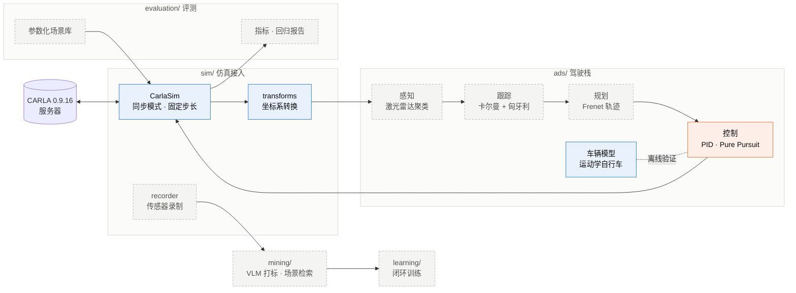
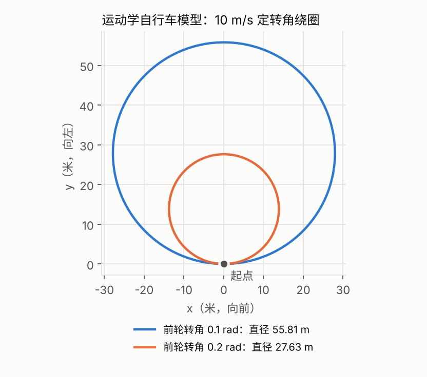
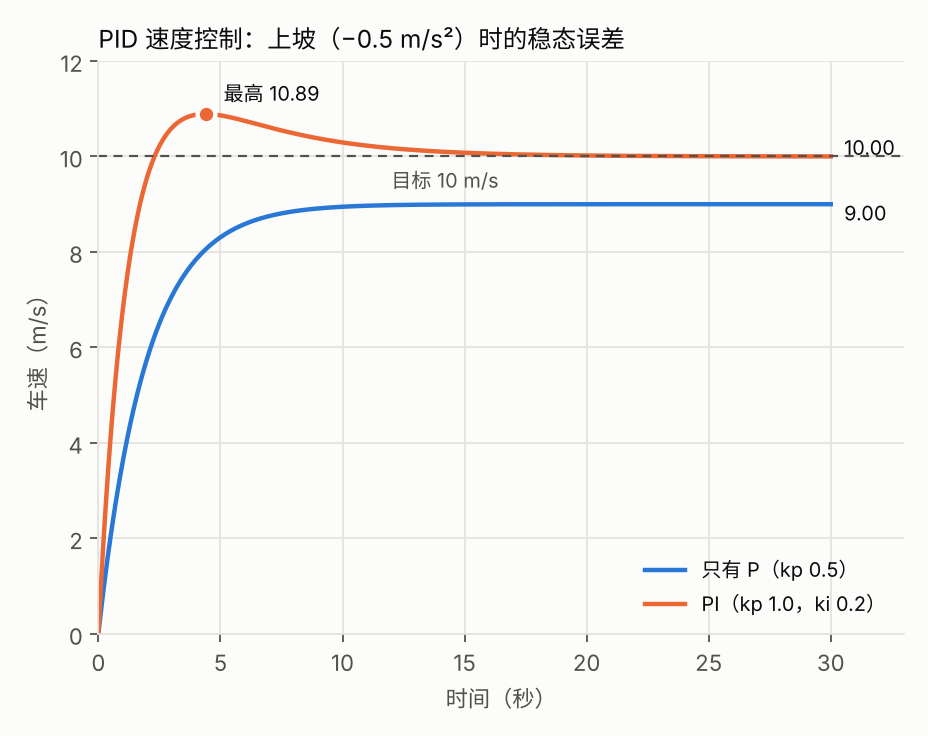

<div align="center">

# highway-sim-eval

**基于 CARLA 的自动驾驶仿真评测与数据闭环平台**

*Closed-loop simulation, evaluation and data flywheel for autonomous driving, built on CARLA.*

[](https://www.python.org/)
[](https://carla.org/)
[](#快速开始)
[](#路线图)

[快速开始](#快速开始) · [系统架构](#系统架构) · [实验记录](#实验记录) · [路线图](#路线图)

</div>

---

从零实现一套模块化驾驶栈，接入 CARLA 做闭环仿真；在此之上搭建批量场景评测、录制回灌和多模态数据挖掘，最后用这套平台闭环训练、迭代一个小型端到端模型。

### 要回答的问题

- 同一组场景下，哪套驾驶系统更安全、更顺、更高效？
- 它在什么情况下失败，失败前发生了什么？
- 改完以后是真的变好了，还是只是这次的场景更容易？
- 开环指标（预测轨迹和真值差多少）和闭环表现（真的开起来怎么样）是否一致？

## 当前进展

| 模块 | 内容 | 状态 |
| --- | --- | --- |
| `ads/vehicle.py` | 运动学自行车模型（后轴参考点，转角限幅） | ✅ 完成 |
| `sim/transforms.py` | CARLA 左手系 ↔ 车辆右手系（位置、航向、单位） | ✅ 完成，CARLA 实车验证 |
| `sim/carla_client.py` | `CarlaSim`：同步模式、固定步长、自车与前车生成、异常安全的资源回收 | ✅ 完成 |
| `ads/control.py` | PID 纵向控制（含防积分饱和）+ Pure Pursuit 横向控制 | ✅ 均已在 CARLA 验证 |
| `ads/planning.py` | IDM 跟车（含接近速度项） | ✅ 已接入 CARLA（剧本前车急刹）；加速度经下层速度闭环（参考车速 + PID）执行 |
| `evaluation/metrics.py` | 横向误差：车到车道中心线（路点折线）的点到线段距离，取代“到最近路点距离”（路点间距 0.5 米时后者有约 0.25 米误差） | ✅ 完成 + 测试；待接入 CARLA |
| `sim/recorder.py` | 相机 / 激光雷达 / GNSS / IMU 录制，带帧号与仿真时间戳 | 📋 计划中 |
| 感知 · 跟踪 · 规划 | RANSAC + DBSCAN、卡尔曼 + 匈牙利、Frenet 轨迹 | 📋 计划中 |
| 评测平台 · 数据挖掘 · 闭环学习 | 见[路线图](#路线图) | 📋 计划中 |

## 系统架构



<sub>蓝色：已完成　橙色：进行中　灰色虚线：计划中</sub>

## 快速开始

**环境**：Python 3.10，CARLA 0.9.16（服务器 + Python 客户端），NVIDIA 显卡显存 8 GB 以上。

```powershell
git clone https://github.com/chasen2041maker/highway-sim-eval.git
cd highway-sim-eval
python -m pip install carla==0.9.16 pytest matplotlib

python -m pytest -q        # 单元测试，纯 Python，不需要启动 CARLA
```

**接入 CARLA**：先启动服务器，再在另一个终端运行示例。

```powershell
# 终端 1：CARLA 安装目录下
.\CarlaUE4.exe -quality-level=Low -windowed -ResX=1280 -ResY=720

# 终端 2：项目根目录下
python -m examples.a2_client_demo
```

> 双显卡笔记本加上 `-prefernvidia`，让 CARLA 跑在独显上。同一时间只运行一个 CARLA 实例，否则后启动的会因 2000 端口被占用而退出。

## 使用示例

```python
import carla
from sim.carla_client import CarlaSim
from sim.transforms import carla_to_ours

with CarlaSim(dt_s=0.05) as sim:            # 同步模式，每帧 0.05 s
    ego = sim.spawn_ego()                    # 生成自车，退出时自动销毁
    for _ in range(60):
        ego.apply_control(carla.VehicleControl(throttle=0.5, steer=0.1))
        frame, sim_time_s = sim.tick()       # 帧号 + 仿真时间
        tf = ego.get_transform()
        x, y, heading = carla_to_ours(tf.location.x, tf.location.y, tf.rotation.yaw)

# 离开 with（包括中途抛出异常）：销毁生成的 actor，恢复服务器原有设置
```

## 实验记录

<p align="center">
  
  
</p>

<p align="center"><sub>两张图由 <code>python -m scripts.readme_figures</code> 生成，数据来自项目自身的模型与控制器。</sub></p>

| 实验 | 设置 | 结果 |
| --- | --- | --- |
| 自行车模型绕圈 | 10 m/s，前轮转角 0.1 / 0.2 rad | 直径 55.81 / 27.63 m，与 2L / tan δ 一致；车速加倍时直径不变、一圈用时减半 |
| PID 上坡 | 目标 10 m/s，坡道 −0.5 m/s² | 只有 P 稳定在 9.00 m/s（稳态误差 1 m/s）；PI 收敛到 10.00 m/s，最高 10.89 m/s |
| PID 接入 CARLA（防积分饱和） | Model 3，平路，目标 8 m/s，kp 1.0，油门上限 1，8 s | ki 0.2、无防饱和：最高 9.46 m/s，8 s 时 8.27 m/s；加防积分饱和：最高 8.27，8 s 时 7.89；ki 调到 0.5：最高 8.11，8 s 时 7.99。维持 8 m/s 的稳态油门约 0.39 |
| Pure Pursuit 接入 CARLA（沿真实车道） | Town10HD 出生点 0；用地图路点每 0.5 m 取 80 m 车道中心线（路口取第一条分支，为左转）；目标 6 m/s，12 s；Ld = 2 / 5 / 10 m | 离车道中心线最大 0.27 / 0.32 / 0.82 m。Ld 10 更早开始转向（1 s 时前轮 8.1° vs Ld 2 的 6.4°）、转得更缓（最大 11.0° vs 12.8°）、更晚回正，出弯切弯 0.82 m，约 5 s 后回到线上；6 m/s 下 Ld 2 未见摆动。由 steer 与前轮角反推 Model 3 前轮最大转角约 70°。该指标是“到最近路点的距离”，路点间隔 0.5 m 带来约 0.25 m 的分辨率误差，0.27 与 0.32 无法区分；待改为点到线段的横向误差 |
| Pure Pursuit 前视距离 | 直道 40 m → 半径 20 m 左转 90° → 直道 40 m；起点偏离路线 3 m，10 m/s；Ld = 2 / 5 / 15 m | 直道越过路线最远 1.23 / 0.27 / 0 m，弯道最大横向误差 0.08 / 0.16 / 1.13 m：Ld 小则来回摆动，Ld 大则切弯；动画讲解见 `docs/a3_pure_pursuit_animation.html` |
| IDM 跟车 · 前车急刹 | 两车 10 m/s、车距 25 m；前车第 5 s 起以 −5 m/s² 刹停；自车目标 15 m/s，制动上限 −8 m/s² | 只看车距：距前车 15 m 才明显制动，最大减速度 5.96 m/s²，最小车距 4.46 m；加入接近速度项后提前到 20 m，最大减速度 3.69 m/s²，最小车距 4.95 m；均未碰撞。时距改为 0.5 s：有接近速度项仍未碰撞（最小 3.50 m，最大减速度 6.69 m/s²），去掉后制动打满 8 m/s² 仍碰撞 |
| IDM 接入 CARLA · 前车急刹（开环踏板） | 复现上一行场景：Town10HD 出生点 80（前方 178 m 直路，`examples/tool_find_straight.py` 筛选），两车 Model 3；前 1 s 两车按剧本保持 10 m/s 后 IDM 接管；前车用 `set_target_velocity` 按剧本以 −5 m/s² 刹停；IDM 加速度直接经 `to_pedals` 作为踏板量 | 未碰撞，最小车距 6.26 / 6.28 m（两次运行）。IDM 输出与手算一致（7.0 s：−0.06 m/s²；去掉接近速度项为 +1.21），但车辆没有按该加速度运动：跟车 10 m/s 时 IDM 输出约 +0.45、实际加速度 ≈ 0（维持车速所需油门）；前车刹停期间 IDM 输出 +0.24 → −0.06，制动踏板最大 0.07，松油门滑行的实际减速度却达 −2.7 m/s²。即“加速度 → 踏板”开环映射有偏差：IDM 的 0 对应油门约 0.45，油门 0 对应约 −2 m/s²；本次偏保守属偶然。单帧极值（IDM 最大减速需求）两次运行为 −0.57 / −0.10，不宜直接作指标 |
| IDM 接入 CARLA · 前车急刹（下层速度闭环） | 同上一行场景；IDM 加速度先积分成参考车速（`shadow += a·dt`），再由 PID（kp 1.0，ki 0.5，u_max 1.0）跟踪参考车速并输出踏板；`CLOSED_LOOP` 开关可切回开环 | 未碰撞，最小车距 4.91 m，IDM 最大减速需求 −3.65 m/s²，与纯模型（4.95 m、−3.69）基本一致；前车刹停期间实际减速度 −0.37 → −3.32 跟随 IDM 输出（−1.04 → −3.63），约滞后 0.5 s；跟车 10 m/s 时 PID 的积分项自行找到约 0.43 的稳态油门，制动踏板最大 0.40（开环时 0.07）。低速（< 3 m/s）接近停车时油门 1.0 与制动 0.40 交替、出现顿挫（车速 0.42 ↔ 1.72），实际减速度单帧极值 −4.62 m/s² 来自这段顿挫而非紧急制动段（−3.32）；待加停车保持逻辑 |
| 三样合起来 · 弯道跟车（纯模型预演） | 直道 40 m → 半径 20 m 左转 90° → 直道，路点间隔 0.5 m；两车 10 m/s、车距 25 m，前车第 3 s 进弯时以 −5 m/s² 刹停在弯内；自车 IDM（目标 15 m/s）+ Pure Pursuit（Ld 5 m）+ 自行车模型；对比“IDM 加速度直接执行”与“参考车速 + PID（ki 0.5，加速度上限 3 m/s²）”；横向误差用点到折线距离（`evaluation/metrics.py`）；`examples/a8_model_drive.py` | 直接执行：最小车距 4.96 m，最大减速度 3.28 m/s²。PID kp 1.0：最小车距 4.36 m，最大减速度 4.46 m/s²——前车制动后 3.5–5 s 实际减速度每一时刻都小于 IDM 需求（4.0 s：−1.73 vs −2.98），与参考车速的差距累积，5.5 s IDM 已放松到 −2.89 时仍以 −4.42 补刹（参考车速 2.46 m/s，实际 4.83 m/s）；kp 3.0：4.97 m、3.51 m/s²，与直接执行一致。离车道中心最远 0.09–0.10 m（制动使过弯车速降低）。说明下层控制的滞后会改变闭环安全指标，只在模型里评测规划器不够。动画：`docs/a8_brake_lag.html` |
| 坐标转换（CARLA 实车） | Model 3，油门 0.5，steer 0.1，3 s | CARLA：y 24.49 → 26.49，yaw 0.98° → 19.77°；转换后：y −24.49 → −26.49，航向 −0.017 → −0.345 rad，与手算一致 |
| 同步模式可复现性 | 同一脚本重复运行；`CarlaSim` 重构前后 | 位置、航向、车速逐位相同 |
| 车型差异 | 同一控制输入，Model 3 vs CarlaCola 卡车 | 3 s 末车速 5.95 vs 1.44 m/s；每行驶 1 m 航向变化均约 0.04 rad，转弯半径与车速无关 |
| 异步 vs 同步 | 服务器空转 | 异步：现实 1 s 推进约 238 帧；同步：不调用 `tick()` 帧号不变 |

<sub>CARLA 实验环境：CARLA 0.9.16，Town10HD_Opt，Windows，RTX 4080 Laptop。</sub>

## 坐标与单位约定

项目内部统一使用车辆右手系（ISO 8855 / ROS REP 103），与 CARLA 交互时在 `sim/transforms.py` 一处转换。

| | 本项目 | CARLA（Unreal Engine 4） |
| --- | --- | --- |
| x | 向前 | 向前 |
| y | **向左** | **向右** |
| z | 向上 | 向上 |
| 航向角 | 弧度，左转为正 | 度，右转为正 |
| 转换 | — | x 不变；y 取反；航向取反并换算单位 |

时间统一用仿真时间（秒）和帧号；每个模块在文档字符串里写明输入、输出、单位和坐标系。

## 目录结构

```text
highway-sim-eval/
├─ ads/              驾驶栈：车辆模型、控制、IDM 跟车（感知、跟踪、变道规划待加入）
├─ sim/              CARLA 连接与同步主循环、坐标转换（传感器录制待加入）
├─ examples/         可直接运行的实验脚本
├─ scripts/          工具脚本（README 配图等）
├─ tests/            单元测试
└─ docs/            动画讲解（浏览器打开）；images/ 为 README 配图
```

后续按功能逐步加入：`scenarios/` 参数化场景库 · `evaluation/` 批量调度与指标 · `dashboard/` 网页看板 · `mining/` 数据挖掘 · `learning/` 闭环训练 · `cpp/` C++ 跟踪器 · `ros2/` ROS 2 发布与录包。

## 路线图

| 阶段 | 目标 | 可展示的成果 | 状态 |
| --- | --- | --- | --- |
| **A** 驾驶栈打通 | 在 CARLA 城市道路里自己开起来 | 激光雷达检测 + 多目标跟踪 + 变道超车演示视频 | 🚧 进行中 |
| **B** 评测与数据闭环 | 批量场景闭环评测 | 几十种场景自动打分、失败回放、版本对比看板 | 📋 |
| **C** 多模态数据挖掘 | 用视觉语言模型理解场景 | 自动打标、一句话检索场景、失败归因，并给出准确率 | 📋 |
| **D** 闭环学习 | 采数据 → 训练 → 评测 → 补数据 | 小型端到端模型的迭代前后指标对比 | 📋 |
| **E** 工程化 | 性能与部署 | C++ 跟踪器、ROS 2 录包、Docker 评测客户端 | 📋 |

<details>
<summary><b>详细清单</b></summary>

**A. 模块化驾驶系统**

- [x] 车辆运动学模型（自行车模型）
- [x] 坐标系转换（CARLA ↔ 车辆右手系），CARLA 实车验证
- [x] CARLA 同步模式主循环（`CarlaSim`）
- [ ] 传感器录制：相机、激光雷达、GNSS、IMU，带帧号与时间戳
- [x] Pure Pursuit 横向控制（模型上验证，前视距离对比实验）
- [x] PID 速度控制接入 CARLA（防积分饱和）
- [x] Pure Pursuit 接入 CARLA（沿地图车道中心线，前视距离对比）
- [ ] 交通流与跟车（IDM 已接入 CARLA 跟剧本前车，下层速度闭环完成；低速停车保持、交通流待做）
- [ ] 激光雷达感知：地面分割（RANSAC）+ 聚类（DBSCAN）+ 3D 框
- [ ] 多目标跟踪：卡尔曼滤波 + 匈牙利匹配 + 航迹管理
- [ ] Frenet 坐标 + 多项式轨迹：变道与超车
- [ ] 全链打通：感知结果替换真值，俯视图回放

**B. 仿真评测与数据闭环**

- [ ] 参数化场景库：邻车加塞、前车急刹、慢车挡路、行人横穿
- [ ] 批量调度：任务队列、超时、失败重试、结果入库
- [ ] 录制与回灌：回放记录数据，对感知和规划做回归
- [ ] 指标：碰撞、TTC、舒适度、路线完成度、驾驶分；置信区间；调参与测试场景分开
- [ ] 回归报告与看板：版本对比

**C. 多模态数据挖掘**

- [ ] 视觉语言模型自动打标，并与仿真真值对比准确率
- [ ] 自然语言检索场景
- [ ] 失败归因与场景生成（指标一律由程序计算，模型只负责分类、说明和生成参数）

**D. 闭环学习**

- [ ] 用 A 的系统批量采集示范数据
- [ ] 训练小模型：俯视图 / 目标列表 → 未来路径与速度
- [ ] 闭环评测，对比开环误差与闭环表现
- [ ] 挖出失败场景，针对性补数据再训练

**E. 工程**

- [ ] C++ 实现的卡尔曼跟踪器（带单元测试，Python 绑定）
- [ ] ROS 2 话题发布与 bag 录制
- [ ] Docker 化的评测客户端

</details>

## 设计原则

- **接口写清楚**：每个模块写明输入、输出、单位、坐标系和时间戳。
- **对照真值**：每个模块都与仿真真值比较，给出误差指标。
- **可复现**：同步模式 + 固定步长 + 固定场景与随机种子，同样的输入得到同样的结果。
- **指标只从记录算**：评测指标一律从运行记录计算，不依赖人工判断。
- **资源安全**：仿真中生成的 actor 和服务器设置，在正常结束或抛出异常时都会回收、还原。

## 参考

- [CARLA Simulator](https://carla.org/) · [CARLA 0.9.16 文档](https://carla.readthedocs.io/en/0.9.16/)
- [HighwayEnv](https://github.com/Farama-Foundation/HighwayEnv)：早期原型（`sim_env.py`、`check_env.py`）所用的二维高速公路环境
