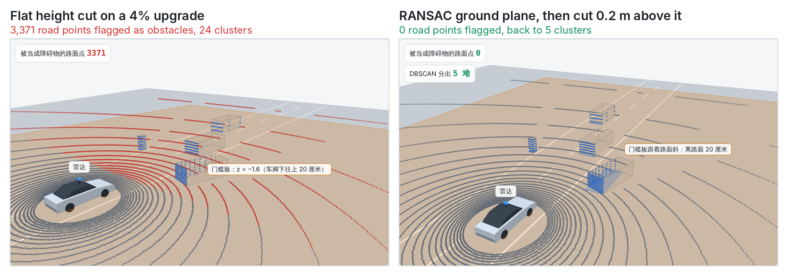
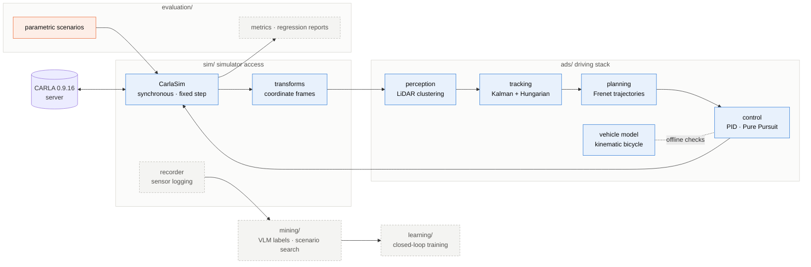
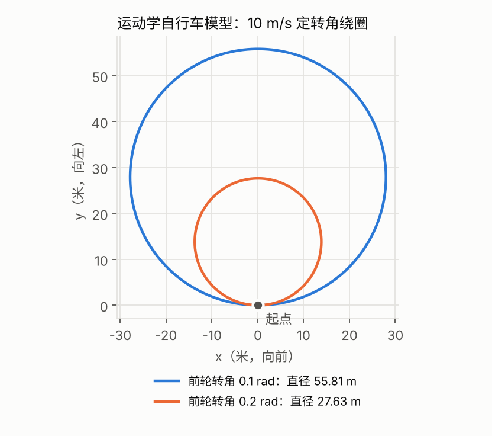
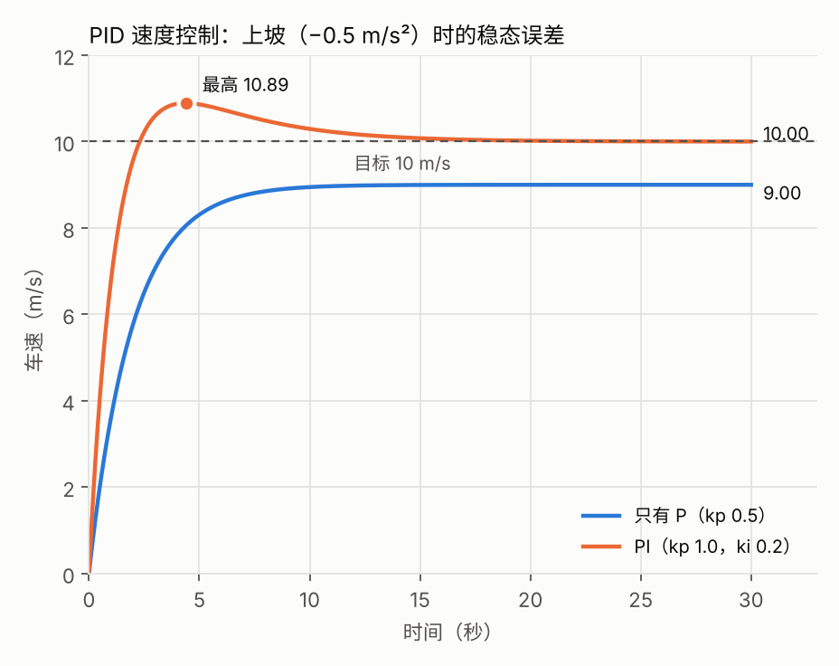

<div align="center">

# highway-sim-eval

**A driving stack I'm writing from scratch, run closed-loop in CARLA, with an evaluation layer on top.**

**English** · [简体中文](README.zh-CN.md)

[](https://www.python.org/)
[](https://carla.org/)
[](https://github.com/chasen2041maker/highway-sim-eval/actions/workflows/tests.yml)
[](#roadmap)
[](https://chasen2041maker.github.io/highway-sim-eval/)

[Interactive explainers](https://chasen2041maker.github.io/highway-sim-eval/) · [What I've found](#what-ive-found-so-far) · [Quick start](#quick-start) · [Roadmap](#roadmap)

</div>

---

<p align="center">
  
</p>

<p align="center">The same LiDAR frame on a 4% upgrade. Left: cutting the ground at a fixed height turns 3,371 road points into obstacles. Right: fit the road with RANSAC first, then cut 0.2 m above it. <a href="https://chasen2041maker.github.io/highway-sim-eval/a5_slope_ground.html">Step through it in 3D</a></p>

## Why I'm building this

I'm a backend and AI-agent engineer moving into autonomous driving. Reading about driving stacks didn't stick, so I'm writing one, one module at a time, and checking every module against the simulator's ground truth. The question I keep asking is the one simulation and evaluation teams ask every day: when a metric says the car drove well, can I trust that number?

The project is built to answer:

- Which driving stack is safer, smoother and faster on the same set of scenarios?
- When it fails, what happened just before?
- After a change, did it really get better, or were the scenarios just easier?
- Do open-loop metrics agree with how the car actually drives closed-loop?

## What I've found so far

- **The metric was wrong before the controller was.** Measuring lane error as "distance to the nearest waypoint" hid up to 0.25 m of error at 0.5 m waypoint spacing, so I replaced it with point-to-segment distance before tuning anything.
- **Integral windup is real in CARLA.** Holding 8 m/s, plain PI overshot to 9.46 m/s. Anti-windup brought the peak down to 8.27 m/s, and to 8.11 m/s after raising the integral gain to 0.5.
- **"Zero acceleration" is not "zero pedal".** Sending IDM's acceleration straight to the pedals left a 6.26 m gap behind a braking car, because the car slowed on its own whenever IDM asked for zero. Closing the loop with a speed PID gave 4.91 m, matching the pure model's 4.95 m.
- **The LiDAR box for the car ahead is 2.30 m short.** Only its rear face is visible, so a min/max box sits on the bumper. No clustering setting fixes it; the distance to the bumper (12.70 m) is still right.
- **A 4% slope breaks a fixed ground cut.** 3,371 road points from 5 m ahead became obstacles and detection precision fell to 0.04. A RANSAC ground plane fixed it (image above).
- **Differencing two LiDAR frames is a bad speedometer.** With ±0.2 m range noise at 10 Hz, the speed of the car ahead was off by up to 5.5 m/s. A constant-velocity Kalman filter on the same data stays within 0.35 m/s after the first second (error σ 1.36 → 0.09 m/s).
- **Losing a car for half a second should not rename it.** Tracking three cars through shuffled, noisy LiDAR boxes, keeping an unmatched track for up to 10 frames held all three IDs through a 0.5 s occlusion. Keeping it for only 3 frames dropped the hidden car at 2.3 s and gave it a new ID at 2.5 s, with its speed estimate starting again from zero. Waiting longer has a cost too: a one-frame guardrail false alarm lived on as a ghost track for a full second. Scored against ground truth, 10 frames vs 3: ID switches 0 vs 1, missed car-frames 0 vs 2, speed error 0.33 vs 0.44 m/s, but false-track frames 11 vs 4. No setting wins every number; the choice depends on which mistake is more dangerous.
- **A lane change that is only right on straight roads.** Planning the lane change in the Frenet frame (offset toward the road's left) and planning it by adding the offset to map y draw the same line on a straight road. In a 90° left curve, the y + d car ended 3.50 m from the left lane centre, back in its own lane, because by the end of the curve "+y" pointed straight ahead. The Frenet car ended 0.00 m from it. Lane change and curve also add up: 2.0 m/s² for the curve alone, 3.19 m/s² peak with the lane change on top.
- **A wrong sign still scored 100% recall.** Moved to CARLA's ray-cast LiDAR with no code changes, the A5 detector found all three cars at a 2 m gate (recall 1.00; precision 0.60, because two roadside poles or signs aren't in the ground-truth list), and the lead car's box was 1.69 m short (rear face only). Then I deliberately skipped the CARLA y flip. The 2 m score didn't move: a pole from across the road, mirrored, landed next to the adjacent-lane car and was matched to it. At a 0.5 m gate recall dropped from 0.33 to 0. One gate isn't enough; check several and look at what got matched.
- **With LiDAR in the loop, the last brake was 54% harder.** Replacing the ground-truth lead car with LiDAR boxes → tracker → lead picked by distance to the route (not by heading) → IDM: no crash and about the same minimum gap (7.65 vs 7.61 m), but the hardest brake went from −4.46 to −6.88 m/s². The lead's braking was seen about 1 s late (at 3.6 s: true 7.00 m/s, seen 9.69): the Kalman filter moves the speed toward each measurement only a little per frame; in the bend the box centre slid forward as the car's side came into view, which looked like the lead speeding up; and at 4.2 s the centre jumped past the 2 m gate, so the track was rebuilt with a new ID (1 → 5) and a speed starting from zero. Seeing it late leaves less room, so the brake has to be harder.
- **Same driver, different simulator, different score.** The same IDM on the same hard-braking scenario braked at most −3.69 m/s² in my own model and −3.44 in HighwayEnv. The driver is the same; the simulators update in a different order. Mine changes the lead car's speed and then moves it; HighwayEnv moves it first at the old speed, so while braking from 10 m/s to a stop the lead covers 10.50 m instead of 9.50 (exact: 10.00). With 0.01 s steps the two get closer (10.05 vs 9.95). When a score changes after switching simulators, check the simulator before blaming the driver.
- **My first scenario couldn't be failed.** Moving the start gap from 25 m to 12 m or 8 m changed nothing that mattered: the lead only braked at 5 s, and by then IDM had already opened the gap back to about 21 m (from 12 m it braked at −5.93 m/s² in the very first frame to do so). The minimum gap stayed 4.95 m, which is just IDM's 5 m standstill gap. With both cars at the same speed, ego able to brake at −8 and the lead at −5, no start gap down to 3 m produced a crash. So the scenario now sets its four numbers at the moment the lead starts braking (gap, ego speed, lead speed, deceleration). 12 m with ego at 20 m/s and the lead at 10 crashes; ego at 18 m/s or a 16 m gap just passes, with 1.34 and 0.50 m left at full braking. A pass/fail column should flag those as near misses, not passes. When I later wrote this scenario as OpenSCENARIO, CARLA's own car-following example does the same: no fixed time, the lead slows down once ego is within 40 m.
- **One car that never cuts in made my old driver slam the brakes.** The cut-in bank starts with a decoy: a car in the next lane that stays there. The old driver took the nearest car as its lead without checking the lane and braked at −8 m/s² at 0 s (phantom braking). The hard-braking bank has only one car, so this never showed up. After picking the lead by lane, judging by the car's centre turned out to be too late: the car is 2 m wide, so by the time the centre crosses the line half the body is already in my lane. Using the body edge plus looking 0.5 s ahead with the lateral speed got all five cut-in questions right; looking 1.0 s ahead also treats cars that only drift towards the line as leads (false braking).
- **Five out of five, then wrong on new questions.** I picked 0.5 s by looking at those five questions. On 40 random unseen ones (seed 0, 20 that cut in and 20 that don't), missed / false brakes were 2 / 0 looking 0 s ahead, 1 / 3 at 0.5 s, 1 / 8 at 1.0 s. Every false brake is a car heading for the line that stops 0.1–0.3 m short: the prediction extrapolates the current lateral speed and doesn't know it will stop. The missed one (question 14) is the opposite: it barely moves sideways at first and then speeds up, so constant-speed extrapolation says "4 s to the line" when it actually crosses at 0.9 s. Adding lateral acceleration (difference of two frames' speeds, s = v·T + ½·a·T²) saves it when looking 1.0 s ahead (braking at 0.3 s), with false brakes 8 → 6; looking 1.5 s ahead over-shoots, false brakes 10 → 14. On a real car acceleration means differencing twice, so the noise is amplified twice and it has to be filtered.
- **Delay causes missed brakes, noise causes false ones.** The driver seeing the road 0.3 s late: missed 2 → 3, false unchanged (seeing late only brakes late). 0.2 m of noise on other cars' lateral position: false 0 → 9, missed unchanged (a car outside the line looks like it's on it for one frame). Requiring 3 frames in a row is a 0.2 s delay I add myself: false 10 → 4, missed 1 → 2; looking 1.0 s ahead buys it back: 1 / 6.
- **Graded a near miss, yet 170 m short in 15 s.** A car doing 3 m/s 20 m ahead: no crash, but my driver can only follow it, averaging 3.7 m/s and covering 170 m less than on an empty road (225 m). The verdict only checks safety; it also needs efficiency (average speed, distance lost). What this scenario really tests is overtaking. A "slow car" as fast as me is an invalid scenario (it really tests starting too close), so `is_valid` lives in the scenario file.
- **Two batches of 1,000 questions agreed on the winner, not on the podium.** 16 driver settings (look-ahead 0 / 0.5 / 1.0 / 1.5 s, 1 or 3 confirmation frames, constant-velocity or constant-acceleration prediction) × 4 road conditions (clean, 0.3 s delay, 0.2 m lateral noise, both) × 1,000 random cut-ins = 64,000 runs per batch, scored as missed brakes × 10 + false brakes. Both batches picked 1.0 s / 1 frame / constant acceleration (2,098 and 2,092); second and third place reshuffled completely. Queried afterwards in SQL: cut-ins closer than 8 m are 18% of the questions but 53% of the misses, and each extra 0.5 s of look-ahead removes fewer misses (−35, −19, 0) while adding more false brakes (+38, +154, +138).
- **Ordered dispatch turned Ray into round-robin.** With 15 slow jobs, Ray's ordered `ActorPool.map` only frees an exam room once its result is collected in job order, so every room still ran 15 jobs (48 s). Letting whichever room is free take the next job (`map_unordered`, rows put back by index) took 20 s with identical rows.
- **One failed first job could lose a 48-minute run.** The CSV header came from the first row; when that job had timed out and had no result columns, the next normal row crashed the save. The fault test missed it because its bad jobs sat in the middle. The header is now every column seen in any row, and the review warns about knob sets with unfinished jobs.
- **My own metric counted a car behind me.** Sorting by minimum gap in SQL showed −140.52 m: the cut-in car I had overtaken moved into my lane behind me and still counted. 2,628 of 128,000 rows are negative, 703 of them without a crash. Missed and false brakes don't use this column. Fixed in B4, which also showed the ruler judged lanes by the car's centre while the driver used its body edge, so a car 0.8 m into my lane was never measured.
- **Only 1 of my 5 result tables can say where it came from.** Every grid table now gets a run manifest (commit, uncommitted files, code fingerprint, command, versions), and every exported dataset carries 7 provenance columns. The two 1,000-question tables were run before the manifest existed and can't be traced.
- **Replay agreed with closed loop without running the simulator.** The 5 cut-in questions recorded frame by frame (612 frames, 29 KB of Parquet, plus one MCAP file per question). Feeding the frames back to the same driver reproduced every decision. A driver looking 0.5 s ahead braked 0.3–0.4 s earlier with no false brake; looking 1.0 s ahead, it false-braked on the car that stops 0.2 m outside my lane, as in closed loop ([replay page](docs/b3_replay.html)).
- **The most dangerous moment is not the closest one.** In the "body 0.8 m into my lane" question, the driver that doesn't look ahead reaches its smallest time-to-collision (0.9 s) at 1.1 s, 4.5 m away and closing at 5 m/s; it is closest (2.68 m) at 1.8 s, when it is already slower than the other car. A minimum-gap metric alone misses the urgent moment.
- **Every driver setting brakes like a switch.** On every real cut-in, at every look-ahead, the brake goes from 0 to −8 m/s² in one 0.1 s step (jerk 80 m/s³); a false brake reaches 108 m/s³ because it brakes and then throttles straight away. Capping the jerk trades distance for comfort (minimum gap 5.68 → 4.98 → 4.14 → 2.77 m at no cap / 20 / 10 / 5 m/s³), the 5 m cut-in crashes with any cap, and capping the release as well over-brakes the car to a stop on the highway. Comfort limits have to be lifted when it is urgent.
- **50 questions pointed the wrong way.** On the 50-question trial, looking 1.0 s ahead missed more than 0.5 s (8.3% vs 4.2%); on 1,000 questions it was the opposite (3.4% / 2.6% vs 6.5%). 95% Wilson intervals on 50 questions span 0.7–25.8%, so the trial could not tell them apart. Picking the setting on 50 / 100 / 200 questions looked like a cost of 132–140 per 100 questions but scored 242–265 on unseen ones, with a setting 16–27% worse; picking on 1,000 got the right one (209.8 → 209.2).
- **The better version crashed where the old one didn't.** B1's pick (0.5 s, constant velocity) against B2's winner (1.0 s, constant acceleration) on 200 unseen cut-ins × 4 road conditions: 79 pairs better, 60 worse, including 2 new crashes. In question 25 the new driver braked early for a slow car that was going to cut in, ended up alongside it, and was hit in the side; the old one simply drove past. The front gap and TTC never saw it, the crash flag did ([regression report](docs/b5_regression_report.html)).
- **The rules picked 27 moments; a person found 1 worth a look.** On real data (nuScenes mini, 10 recorded drives) I mined hard cases with the B4 rulers. Treating my lane as a straight band ahead of the bumper picked 27 moments; in a left turn the band ran into the roadside works. Using the path the car actually drove in the next 5 s left 13; counting only things moving my way (not cars turning past me while I wait at a junction) left 1: an SUV crossing, the driver braking to −3.24 m/s². The price: people walking across are now invisible to the rules. On 50 uniformly sampled frames the rules caught 1 of 2 events.
- **Call the rule's estimate "trustworthy" and the vision model believes it.** I asked DeepSeek to review the picked moments from the photo. With "these numbers are reliable" and "dangerous = TTC < 1.5 s" in the prompt, it called a TTC of 1.0 s "dangerous" while I was standing still and a car passed in front. After "speed and acceleration are measured; TTC is the rule's estimate and may be wrong", it got it right and wrote that the rule had treated a crossing car as a lead car (1/3 → 3/3 on three tuning cases). Start the question with "the driver braked hard" and it invents a reason for a harmless photo.
- **Three agents were no more accurate than one model, at 2–3x the tokens.** Looker / reader / judge vs a single model: 2/3 each on three tuning cases, 16,876 vs 7,577 tokens. Told "14.8 m ahead, 1.2 m right", the looker described the wrong person twice (a vision model can't measure distances in a photo); boxing the target fixed that, and the error moved to another case.
- **Most of the model's mistakes were mistakes in the labelling spec.** On a 51-frame answer key (one frame every 4 s per drive plus the rule's pick; pre-labelled by an LLM, the 5 unsure ones reviewed by me) the model caught 3/3 and was right on 3 of the 8 it flagged; all five extras were "a car crossing at a junction while I ease off". The key itself was inconsistent there: a pedestrian crossing at −0.24 counted, cars crossing at −0.53 didn't. Writing down "pedestrians in my path count; cars only if I brake harder than −1.5 m/s²" gave 3/4. Those 51 frames have now been used to tune the spec; a real score needs new data.
- **CI caught me on day one.** The first GitHub Actions run failed because scikit-learn was missing from `requirements.txt`. It had only ever worked on my laptop.

## At a glance

| Module | What it does | Result | Status |
| --- | --- | --- | --- |
| Vehicle model | Kinematic bicycle model (rear-axle reference, steering limit) | Circle diameter matches 2L / tan δ | Done |
| Longitudinal control | PID speed control with anti-windup | In CARLA at 8 m/s, peak speed 9.46 → 8.11 m/s | Done, verified in CARLA |
| Lateral control | Pure Pursuit along CARLA lane waypoints | Look-ahead 2 / 5 / 10 m: max deviation 0.09 / 0.17 / 0.78 m (point-to-segment; nearest-waypoint said 0.27 / 0.32 / 0.82) | Done, verified in CARLA |
| Car following | IDM with a closing-speed term, executed through a reference speed and a PID loop | Hard braking ahead: minimum gap 4.91 m in CARLA vs 4.95 m in the model | Done; stop-and-hold also in CARLA (restarts after stopping 4 → 0) |
| Evaluation metric | Point-to-segment lateral error | Nearest-waypoint distance hid up to 0.25 m | Done |
| LiDAR perception | Ground removal (height cut, RANSAC on slopes), DBSCAN, boxes on a simulated 32-beam scan | Lead car box 2.30 m short (rear face only); slope: 3,371 → 0 false ground points | Done; also on CARLA's LiDAR (2 m gate recall 1.00, precision 0.60) |
| Detection evaluation | Greedy one-to-one matching on center distance; recall, precision, center error | Recall 0.40 / 0.60 / 1.00 at nuScenes gates 0.5 / 2 / 4 m | Done |
| Tracking | Lead-car speed from LiDAR distances with a constant-velocity Kalman filter; three cars tracked through shuffled boxes with Hungarian matching (2 m gate) and track IDs; scored against ground truth (position / speed error, ID switches, missed, false tracks) | Max speed error 5.55 m/s (frame differencing) → 0.35 m/s (Kalman); `max_misses` 10 vs 3: ID switches 0 vs 1, false-track frames 11 vs 4 | Done (pure Python) |
| Lane change | MOBIL decision (safety + incentive); quintic (minimum-jerk) lateral profile d(t); Frenet (s, d) to map (x, y); followed with the bicycle model and Pure Pursuit | 3.5 m in 2 / 4 / 6 s: peak lateral acceleration 5.05 / 1.26 / 0.56 m/s²; in a 90° curve: Frenet path ends in the left lane, map y + d ends 3.50 m off | Done (pure Python) |
| Perception in the loop | LiDAR boxes → tracker → lead car picked by distance to the route centre line → IDM + PID + Pure Pursuit; scored on ground truth | vs ground-truth lead: no crash, min gap 7.65 vs 7.61 m, hardest brake −6.88 vs −4.46 m/s² (braking seen about 1 s late) | Done (pure Python); CARLA next |
| Scenario runner | First scenario in HighwayEnv (hard braking ahead): the driver sees only the simulator's observations, scoring uses only the logged true state | Same IDM: hardest brake −3.44 m/s² in HighwayEnv vs −3.69 in my own model (update order). Five-question hard-braking bank: 1 crash, 2 near misses (1.34 / 0.50 m left). 40 random cut-ins: 1 missed / 3 false brakes (looking 0.5 s ahead). Slow car: near miss, yet 170 m lost in 15 s | In progress (three scenarios + random questions + fault injection + OpenSCENARIO) |
| Batch runner | Frozen job cards; process pool with timeouts, retries and a status per job; save-as-you-go log and resume (the job card is the key, code fingerprint); run manifest; Ray tasks and actors | 64,000 runs per batch; 240 jobs in 88 → 16 s on 1 → 16 processes; Ray pull-based dispatch 48 → 20 s | Done (restarting a crashed Ray actor left for Linux / WSL2) |
| Results and replay | Grid tables to Parquet, queried with DuckDB SQL; datasets that carry their provenance; frame-by-frame recording, open-loop replay, MCAP | 6.5 MB CSV → 0.16 MB Parquet, same query 95 → 9 ms; replay reproduces every recorded decision | Done (CARLA sensor recording later) |
| Metrics | Front gap (cars ahead whose body is in my lane), minimum TTC, maximum jerk; 95% Wilson intervals; settings picked on tuning questions and scored on unseen ones | Most urgent ≠ closest (TTC 0.9 s at 4.5 m vs 2.68 m later); 50-question conclusions flip at 1,000 | Done (route completion and driving score with CARLA) |
| Regression report | Two versions on the same unseen questions and noise; paired question by question, worse / better / same by outcome level; HTML report with side-by-side replays of every changed pair | v1 → v2: 79 better, 60 worse, 2 new crashes, each one replayable | Done |
| Hard-case mining and review (first version) | Reads the 13 nuScenes JSON tables directly; rules pick moments (TTC, hard braking; "my path" = the next 5 s of the ego trajectory, only things moving my way); a vision model reviews photo + measurements + two label scales → a checked JSON; single model vs three roles; answer key + recall / precision / confusion matrix + intervals | Rules 27 → 13 → 1; model recall 3/3, precision 3/8 (3/4 after spec v2, on tuning data) | In progress: a fixed workflow working on nuScenes mini; tool-calling agent, reviewing B5 simulation results and full nuScenes still to do |

214 Python unit tests and 21 C++ tests (googletest), with expected values worked out by hand, run by GitHub Actions on every push.

## Architecture



Blue = done · orange = in progress · dashed grey = planned

## Quick start

**Requirements**: Python 3.10; CARLA 0.9.16 (server and Python client) and an NVIDIA GPU with 8 GB or more for the CARLA examples.

```powershell
git clone https://github.com/chasen2041maker/highway-sim-eval.git
cd highway-sim-eval
python -m pip install -r requirements.txt pytest   # pinned dependencies (the same set CI installs)
python -m pip install carla==0.9.16 matplotlib      # only for the CARLA examples and plots

python -m pytest -q        # unit tests: pure Python, no CARLA needed; GitHub Actions runs them on every push
python -m examples.b_eval.b1_highway_brake --show   # first scenario in HighwayEnv, no CARLA needed: hard braking ahead, in a window
```

**Running against CARLA**: start the server, then run an example from a second terminal.

```powershell
# terminal 1: in the CARLA install folder
.\CarlaUE4.exe -quality-level=Low -windowed -ResX=1280 -ResY=720

# terminal 2: in the project root
python -m examples.a_stack.a2_client_demo
```

> On laptops with two GPUs add `-prefernvidia` so CARLA uses the discrete card. Run one CARLA instance at a time; a second one exits because port 2000 is taken.

## Usage

```python
import carla
from sim.carla_client import CarlaSim
from sim.transforms import carla_to_ours

with CarlaSim(dt_s=0.05) as sim:            # synchronous mode, 0.05 s per frame
    ego = sim.spawn_ego()                    # spawns the ego car; destroyed on exit
    for _ in range(60):
        ego.apply_control(carla.VehicleControl(throttle=0.5, steer=0.1))
        frame, sim_time_s = sim.tick()       # frame number + simulation time
        tf = ego.get_transform()
        x, y, heading = carla_to_ours(tf.location.x, tf.location.y, tf.rotation.yaw)

# leaving the with-block (even on an exception) destroys spawned actors and restores the server settings
```

## Experiment log

Every row comes from a script in `examples/`; the setup column says what was run.

<details>
<summary><b>Show all experiments (CARLA and pure Python)</b></summary>

<p align="center">
  
  
</p>

<p align="center">Both figures are generated by <code>python -m scripts.readme_figures</code> from the project's own model and controller.</p>

| Experiment | Setup | Result |
| --- | --- | --- |
| Bicycle model circles | 10 m/s, front-wheel angle 0.1 / 0.2 rad | Diameter 55.81 / 27.63 m, matching 2L / tan δ; doubling the speed keeps the diameter and halves the lap time |
| PID on a slope | Target 10 m/s, slope −0.5 m/s² | P only settles at 9.00 m/s (1 m/s steady-state error); PI converges to 10.00 m/s, peak 10.89 m/s |
| PID in CARLA (anti-windup) | Model 3, flat road, target 8 m/s, kp 1.0, throttle limit 1, 8 s | ki 0.2 without anti-windup: peak 9.46 m/s, 8.27 m/s at 8 s; with anti-windup: peak 8.27, 7.89 at 8 s; ki 0.5: peak 8.11, 7.99 at 8 s. Holding 8 m/s takes about 0.39 throttle |
| Pure Pursuit in CARLA (real lane) | Town10HD spawn 0; 80 m of lane centre line from map waypoints every 0.5 m (first branch at the junction, a left turn); target 6 m/s, 12 s; Ld = 2 / 5 / 10 m | Max distance from the centre line 0.27 / 0.32 / 0.82 m. Ld 10 starts turning earlier (front wheel 8.1° at 1 s vs 6.4° for Ld 2), turns more gently (max 11.0° vs 12.8°) and straightens later, cutting the corner by 0.82 m and returning to the line after about 5 s; no weaving with Ld 2 at 6 m/s. Steer vs wheel angle implies a Model 3 maximum wheel angle of about 70°. This metric was "distance to the nearest waypoint", which carries about 0.25 m of resolution error at 0.5 m spacing, so 0.27 and 0.32 can't be told apart. Rerun with point-to-segment error: 0.09 / 0.17 / 0.78 m. The old number was the hypotenuse of the true offset and the along-track offset to the nearest waypoint (up to 0.25 m): √(0.09² + 0.25²) = 0.27, √(0.78² + 0.25²) = 0.82 |
| Pure Pursuit look-ahead | 40 m straight → 90° left turn of radius 20 m → 40 m straight; start 3 m off the path, 10 m/s; Ld = 2 / 5 / 15 m | Furthest overshoot on the straight 1.23 / 0.27 / 0 m, max lateral error in the bend 0.08 / 0.16 / 1.13 m: short look-ahead weaves, long look-ahead cuts corners. Explainer: `docs/a3_pure_pursuit_animation.html` |
| IDM car following, lead car brakes hard | Both cars 10 m/s, gap 25 m; lead brakes at −5 m/s² from 5 s to a stop; ego target 15 m/s, braking limit −8 m/s² | Gap term only: brakes noticeably only at 15 m, max deceleration 5.96 m/s², minimum gap 4.46 m; with the closing-speed term braking starts at 20 m, max 3.69 m/s², minimum gap 4.95 m; no collision in either. With a 0.5 s time headway: still no collision with the closing-speed term (minimum 3.50 m, max 6.69 m/s²); without it the car collides even at full 8 m/s² braking |
| IDM in CARLA, hard braking (open-loop pedals) | Same scenario: Town10HD spawn 80 (178 m of straight road, found with `examples/a_stack/tool_find_straight.py`), two Model 3s; both scripted at 10 m/s for 1 s, then IDM takes over; the lead brakes at −5 m/s² via `set_target_velocity`; IDM acceleration goes straight to the pedals through `to_pedals` | No collision, minimum gap 6.26 / 6.28 m (two runs). IDM output matches hand calculation (7.0 s: −0.06 m/s²; +1.21 without the closing-speed term), but the car did not follow it: following at 10 m/s IDM asks for about +0.45 while actual acceleration ≈ 0 (the throttle needed to hold speed); while the lead stops IDM goes +0.24 → −0.06, brake pedal max 0.07, yet coasting off the throttle gives −2.7 m/s². The open-loop map from acceleration to pedals is biased: IDM's 0 is about 0.45 throttle, and 0 throttle is about −2 m/s². Being conservative here was luck. The single-frame extreme (IDM's peak braking demand) was −0.57 / −0.10 across two runs, so it is not a usable metric |
| IDM in CARLA, hard braking (inner speed loop) | Same scenario; IDM acceleration is integrated into a reference speed (`shadow += a·dt`) and a PID (kp 1.0, ki 0.5, u_max 1.0) tracks it and outputs the pedals; `CLOSED_LOOP` switches back to open loop | No collision, minimum gap 4.91 m, IDM peak braking demand −3.65 m/s², in line with the pure model (4.95 m, −3.69). While the lead stops, actual deceleration −0.37 → −3.32 follows IDM (−1.04 → −3.63) about 0.5 s late; following at 10 m/s the PID integral finds about 0.43 throttle on its own; brake pedal max 0.40 (0.07 open loop). Below 3 m/s near the stop, throttle 1.0 and brake 0.40 alternate and the car jerks (speed 0.42 ↔ 1.72); the single-frame extreme of −4.62 m/s² comes from this jerk, not the emergency braking (−3.32). Needs stop-and-hold logic |
| All three together: car following in a bend (pure model) | 40 m straight → 90° left turn of radius 20 m → straight, waypoints every 0.5 m; both cars 10 m/s, gap 25 m, the lead brakes at −5 m/s² to a stop inside the bend at 3 s; ego IDM (target 15 m/s) + Pure Pursuit (Ld 5 m) + bicycle model; compares executing IDM's acceleration directly with reference speed + PID (ki 0.5, acceleration limit 3 m/s²); lateral error as point-to-polyline distance (`evaluation/metrics.py`); `examples/a_stack/a8_model_drive.py` | Direct: minimum gap 4.96 m, max deceleration 3.28 m/s². PID kp 1.0: minimum gap 4.36 m, max deceleration 4.46 m/s². From 3.5 to 5 s after the lead brakes, actual deceleration is below IDM's demand at every moment (4.0 s: −1.73 vs −2.98); the gap to the reference speed builds up, so at 5.5 s, with IDM already easing to −2.89, the car still brakes at −4.42 to catch up (reference 2.46 m/s, actual 4.83 m/s). kp 3.0: 4.97 m, 3.51 m/s², same as direct. Max distance from the lane centre 0.09–0.10 m (braking slows the car in the bend). Lag in the low-level controller changes closed-loop safety metrics, so evaluating a planner only in the model isn't enough. Explainer: `docs/a8_brake_lag.html` |
| Stop-and-hold (pure model) | Same bend scenario, PID kp 1.0; `StopHold` in `ads/planning.py`: enters when ego < 1.0 m/s, lead < 0.5 m/s and gap < 8 m (holds the brake, resets the PID integral, sets the reference speed to 0); exits when the lead > 1.0 m/s or gap > 11 m (different enter and exit thresholds, i.e. hysteresis); 5 unit tests | Without it, at low speed IDM accelerates again to close the gap from about 7.6 m to 5 m: speed 0.59 → 1.69 → 0 m/s (stops and starts once more), ending at 4.36 m. With it: hold at 7.2 s, no restart, stops at 7.61 m. The same effect showed in CARLA as throttle 1.0 alternating with brake 0.4 at low speed; in CARLA (`python -m examples.a_stack.a4_carla_follow hold`) stop-and-hold took the restarts after stopping from 4 to 0 and the final gap from 4.93 to 6.65 m. Explainer: `docs/stop_hold.html` |
| LiDAR ground removal (simulated LiDAR, pure Python) | `sim/fake_lidar.py`: numpy ray casting of a 32-beam LiDAR (+10° to −30°, 0.4° horizontal, 50 m range, 2 cm range noise σ), mounted 1.8 m above the ground; scene of 5 boxes (lead car 15 m ahead, a car in the left lane, a parked car, a pedestrian, a car behind); `remove_ground` in `ads/perception.py` cuts at a height threshold; `examples/a_stack/a5_fake_scan.py`, `examples/a_stack/a5_remove_ground.py`; 3 unit tests | One sweep, 28,800 rays → 19,897 points: ground 19,164 (96.3%), objects 733; the 22 downward beams land as rings (3.1–35.5 m, 17 of them within 10.9 m); no ground points in my lane beyond 17.3 m (occlusion: beams that clear the lead car's roof land about 104 m out, beyond range). Threshold z > −1.6 m (0.20 m above ground): 0 ground points left, 650 / 733 object points kept (the bottom 0.2 m goes too); −1.79 m (0.01 m above ground): range noise lets 1,069 ground points through, 725 object points kept. Explainers: `docs/a5_lidar_scan.html` (sweep, occlusion), `docs/a5_lidar_mounting.html` (where production cars and robotaxis mount LiDARs) |
| LiDAR clustering (DBSCAN, pure Python) | The 650 points left after ground removal, clustered top-down on (x, y) with `cluster_points` in `ads/perception.py` (sklearn DBSCAN), min_samples 5; `examples/a_stack/a5_cluster.py` counts clusters per object against ground truth; 5 unit tests | eps 0.5 m: 8 clusters. The car behind splits in two (0.86 m without points between the hood face and the roof: the 10th beam grazes the top of the hood and lands on the roof only at 10.67 m), and the parked car splits in three. eps 1.0 m: exactly 5 clusters, the 4 points on the far left-lane car are noise. eps 5.0 m: 4 clusters, the lead car and the parked car (3.62 m apart) merge, with the cluster centre (8.8, −2.9) on empty road between them. eps must be larger than the largest gap inside an object and smaller than the smallest gap between objects (about 1.0–3.5 m here). Explainers: `docs/a5_dbscan.html` (core points, expansion, noise), `docs/a5_roof_gap.html` (where the roof gap comes from) |
| LiDAR boxes (axis-aligned, pure Python) | The 5 clusters at eps 1.0 m; `cluster_to_box` in `ads/perception.py` takes the min / max of x and y per cluster → centre + size; `examples/a_stack/a5_box.py` prints centre error against ground truth and plots a top view; 2 unit tests | Centre error: pedestrian 0.02 m, parked car 0.31 m (seen at an angle, rear + side visible, an L shape), car behind 1.83 m, lead car 2.30 m, left-lane car 2.30 m. The lead car is hit only on its rear face (105 points, box 0.08 m long): its roof is only 0.3 m below the LiDAR, so a beam would need to point 0.99°–1.35° down to land on it, while neighbouring beams are 1.29° apart (−0.32° clears the roof, −1.61° hits the rear at 1.44 m); 0 points on the roof. The min/max box centre sits on the rear face, half a car length (4.6 / 2 = 2.3 m) closer to the LiDAR. The distance to the rear (12.70 m) is still correct; only the centre is off. Explainers: `docs/a5_cluster_box.html` (points → box), `docs/a5_box_offset.html` (side view of the roof gap, I and L shapes from above) |
| LiDAR detection evaluation (pure Python) | The 5 boxes above; `detection_metrics` in `evaluation/metrics.py`: distances between every box centre and every true centre, repeatedly take the closest pair, stop once it exceeds the gate, one-to-one (greedy matching; the boxes have no confidence score); `examples/a_stack/a5_eval.py` evaluates at the nuScenes centre-distance gates 0.5 / 1 / 2 / 4 m; 7 unit tests | Gates 0.5 / 1 m: 2 matches (pedestrian, parked car), recall = precision = 0.40, mean centre error 0.17 m; 2 m: plus the car behind, 0.60 / 0.60, 0.72 m; 4 m: all 5 matched, 1.00 / 1.00, 1.35 m. The lead and left-lane cars are seen only from behind (centre 2.30 m off), so at the 2 m gate one box counts as both a miss and a false alarm. The gate decides how far off still counts as found; a single gate can't measure both "found it" and "found it accurately", hence averaging over several gates. Explainers: `docs/a5_match.html` (matching rule, gates), `docs/a5_rear_face.html` (only the rear face, unrelated to eps) |
| Ground removal on a slope (RANSAC, pure Python) | `ground_slope = 0.04` in `sim/fake_lidar.py` (4% upgrade: road z = −1.8 + 0.04·x); `examples/a_stack/a5_slope.py` compares the fixed height cut (`remove_ground`, z > −1.6) with a RANSAC ground plane (3 random points per plane, count inliers within 0.15 m, keep the best of 50 draws; points more than 0.2 m above the plane are obstacles) | Height cut: the road rises above the threshold 5 m ahead (0.20 / 0.04), 3,371 of 19,314 road points become obstacles, 24 DBSCAN clusters, recall 0.20 and precision 0.04 at the 2 m gate (0.60 / 0.60 on flat ground), a "wall" 5 m ahead that would trigger phantom braking. RANSAC: best plane z = −1.78 + 0.041·x (19,350 inliers; a candidate through a roof point got 924, one from three points too close together 11,808), 0 road points left, 5 clusters, recall / precision 0.60 / 0.60. Least squares over all points is off by 3 cm and keeps 22 fewer object points (96% of this frame is road; it gets dragged off when there are more non-ground points). Explainer: `docs/a5_slope_ground.html` (3D steps + side-view RANSAC slow motion) |
| Speed from LiDAR distances (pure Python) | I follow at 20 m/s, the lead car does 18 m/s, starting 20 m ahead; distance measured each frame at 10 Hz with 0.2 m noise σ, 5 s; `diff_speed` in `ads/tracking.py` takes the difference of neighbouring frames ÷ 0.1 s; `examples/a_stack/a6_diff_speed.py`; 2 unit tests | True closing speed −2.00 m/s. Differenced speed averages −1.99 but ranges from −7.50 to +3.55 (error σ 2.13, max 5.55 m/s): dividing by 0.1 s multiplies the range noise by 10, and one bad frame pushes its two neighbouring speeds in opposite directions |
| Kalman filter for the lead car's speed (pure Python) | Same data as the row above; `KalmanCV` in `ads/tracking.py` (state: distance and speed; `predict` pushes the distance ahead at the current speed, `update` blends in the measured distance with gain K; q = 1, r = 0.04, initial speed 0 ± 5 m/s); `examples/a_stack/a6_kalman.py`; 5 unit tests | After the first second: speed error σ 0.09, max 0.35 m/s (differencing: 1.36, 5.55). At 4.0 s differencing gives −7.50 m/s, the filter −1.97. K (how much of the measured distance is taken in) falls 0.97 → 0.59 → 0.36 over the first 10 frames and settles at 0.27; the speed starts from 0 and reaches −2 in about 0.4 s. Explainer: `docs/a6_kalman.html` |
| Multi-object tracking (pure Python) | `sim/fake_traffic.py`: three cars ahead (same lane 20 m closing at 2 m/s, left lane 12 m pulling away at 1 m/s, right lane 30 m closing at 3 m/s and hidden 2.0–2.4 s), box centres with 0.2 m noise σ in shuffled order, one guardrail false alarm at 3.5 s; `MultiTracker` in `ads/tracking.py`: each track holds two `KalmanCV` (x, y) and a miss counter; every frame predict → distance table → `match_tracks` (scipy `linear_sum_assignment`: one-to-one, minimum total distance, 2 m gate) → update matched tracks → drop tracks unmatched for more than `max_misses` frames → new IDs for unclaimed boxes; `examples/a_stack/a6_multi_track.py`; 14 unit tests | `max_misses` 10: IDs 1–3 follow the same cars for all 51 frames; the false alarm becomes ghost ID 4 (3.5–4.5 s) and is dropped at 4.6 s. `max_misses` 3: the hidden right-lane car is dropped at 2.3 s and comes back as ID 4 at 2.5 s (an ID switch: its speed restarts from 0 and the track wobbles for about half a second); the ghost becomes ID 5. Hungarian vs greedy on a two-track case: total distance 2.3 m vs 4.3 m. Explainer: `docs/a6_multi_track.html` |
| Tracking evaluation (pure Python) | Same scene as the row above, run twice (`max_misses` 10 and 3); `tracking_metrics` in `evaluation/metrics.py` matches tracks to ground-truth cars every frame with the same `match_tracks` (one-to-one, 2 m gate), then counts position / speed error over matched pairs, ID switches (a car matched to a different ID than last time; gaps and first matches do not count), missed cars and unmatched tracks per frame; `examples/a_stack/a6_track_eval.py`; 7 unit tests | 51 frames × 3 cars. `max_misses` 10 vs 3: position error 0.13 vs 0.14 m, speed error 0.33 vs 0.44 m/s, ID switches 0 vs 1, missed 0 vs 2 car-frames (2.3 and 2.4 s), false tracks 11 vs 4 track-frames (the guardrail ghost). 10 wins four of five numbers and loses only on the ghost |
| Lane change in a curve (pure Python) | Lane centre line: 30 m straight, 90° left curve of radius 50 m, 60 m straight; 10 m/s; lane change of 3.5 m starting at 4 s (already in the curve) and taking 4 s, `lane_change_d` in `ads/planning.py`; two planned paths: `frenet_to_xy(ref, s, d)` vs (centre line point) + (0, d) in map coordinates; both followed by the bicycle model + Pure Pursuit (look-ahead 6 m) for 14 s; `examples/a_stack/a7_lane_change.py`; 13 unit tests incl. MOBIL | Frenet: 0.00 m from the left lane centre at the end, peak lateral acceleration 3.19 m/s² (curve alone 2.0). Map y + d: 3.50 m from the left lane centre, 0.00 m from its own lane centre; peak 2.92 m/s². Explainers: `docs/a7_lane_change.html`, `docs/a7_curve_lane_change.html` |
| Curve following in CARLA (ground-truth lead) | Town10HD spawn 29 (found by `pick_spawn`: 56.5 m straight, then a 103° left turn); the lead car has physics off, is placed on the route every frame and brakes at −5 m/s² 5 m into the bend; IDM + reference speed + PID + Pure Pursuit; kp 1 / 3, with and without stop-and-hold; `examples/a_stack/a8_carla_drive.py` | kp 1: max distance from the lane centre 0.22 / 0.21 m (model 0.09–0.10: sharper bend, steering lag), restarts after stopping 2 / 0, final gap 4.66 / 6.09 m. kp 3: 0.21 / 0.20 m, 3 / 0 restarts, 4.92 / 6.58 m. A larger kp jerks more at low speed (a small speed error already saturates the pedal). With stop-and-hold the hardest deceleration (−4.87 m/s² at kp 3) is the moment of stopping itself, which stop-and-hold doesn't cover |
| LiDAR detection in CARLA | Town10HD spawn 80: lead car 15 m ahead, a car 12 m behind, one in the adjacent lane 24 m ahead; CARLA ray-cast LiDAR, 32 beams, 50 m, 1.8 m on the roof, one full turn per frame, no random dropout; the A5 pipeline unchanged (ground cut at −1.6 m, DBSCAN 1.0 / 5, boxes); `examples/a_stack/a5_carla_lidar.py` (`noflip` keeps CARLA's y axis; `show` draws each step in the CARLA window) | 24,168 points → 384 after ground removal → 5 clusters. 2 m gate: recall 1.00, precision 0.60 (the two extra boxes are roadside poles or signs, not in the ground truth); lead car centre 1.69 m short (rear face only; 2.30 on the simulated LiDAR); 0.5 m gate: recall 0.33. `noflip`: the 2 m score is identical, but the adjacent-lane car is matched to a mirrored pole from across the road; 0.5 m gate: recall 0 |
| Perception in the loop (pure Python) | Same bend scenario as "All three together", plus a car parked in the right lane 36 m ahead; every frame: simulated LiDAR scan (ground-truth labels thrown away) → `detect` (ground cut, DBSCAN, box centres) → `MultiTracker` (2 m gate, 10 frames) → `pick_lead` (ahead of me, within 1.75 m of the route centre line in map coordinates, nearest) → gap = centre distance − 4.7 m, lead speed = my speed + relative speed along the line of sight → IDM + PID; scored on ground truth; `examples/a_stack/a8_perception_drive.py`; 4 unit tests | Ground truth vs LiDAR: minimum gap 7.61 vs 7.65 m, hardest brake −4.46 vs −6.88 m/s², no collision in either. LiDAR gap − true gap: mean −0.80 m (−2.36 to +0.21: rear face only on the straight, side visible in the bend). Lead speed error mean 0.47 m/s; braking seen about 1 s late (3.6 s: true 7.00, seen 9.69 m/s); at 4.2 s the lead's ID switched 1 → 5 and its speed restarted from 0. The parked car was never taken as the lead; picking by heading instead takes it in the bend and hits it at about 43 km/h at 5.6 s |
| Hard braking in HighwayEnv (pure Python) | The scenario of "IDM car following, lead car brakes hard" in `highway-v0`: 3 lanes, no background traffic, 10 Hz, Kinematics observation (not normalised), continuous longitudinal action ±8 m/s²; the driver (IDM) sees only the observation, the score uses only the logged true state; `examples/b_eval/b1_highway_brake.py` (`--show` opens a window); 1 unit test | Minimum gap 4.95 m (12.0 s), hardest brake −3.44 m/s² (my model: −3.69), minimum TTC 2.15 s (2.10), no collision; the same numbers with the window open. The difference is update order: my model brakes the lead and then moves it, HighwayEnv moves it at the old speed and then brakes, so the lead covers 10.50 m instead of 9.50 m while stopping from 10 m/s (exact 10.00; 10.05 vs 9.95 with 0.01 s steps). Switching my model to move-then-brake also gives −3.44. Explainer: `docs/b1_update_order.html` |
| Scenario bank: hard braking ahead (HighwayEnv) | `scenarios/lead_brake.py`: `LeadBrake` = one concrete scenario (gap, ego speed, lead speed, lead deceleration, all at the moment the lead starts braking, which is 0 s), `RANGES` = the logical scenario; `examples/b_eval/b1_scenarios.py` runs the same IDM over the five questions in `BANK`; 6 unit tests | Equal speeds, 25 / 12 m: no crash, 4.95 m (from 12 m: −5.93 m/s² in the first frame). Ego 20, lead 10, 12 m: crash at 1.5 s. Ego 18, 12 m: 1.34 m left; ego 20, 16 m: 0.50 m left, both at full −8 m/s². With the lead braking at 5 s instead, start gaps of 25 / 12 / 8 m had all become 21–23 m by 5 s and all ended at 4.95 m |
| Scenario bank: cut-in (HighwayEnv) | `scenarios/cut_in.py`: `CutIn` (gap, ego speed, its speed, seconds to cut in, how deep; 0 s = a decoy that stays in its lane), lateral motion from the A7 quintic; `examples/b_eval/b1_cut_in.py`: five questions (decoy, cut-in at 10 / 5 m, on the line (body 0.8 m in), near the line (body 0.2 m out)) × looking 0 / 0.5 / 1.0 / 1.5 s ahead; the driver split into `pick_lead` (sideways: is the body edge over the line, or will it be within T s) + `follow` (IDM, front and back) | Old driver: −8 at 0 s on the decoy (phantom braking). Body edge, no prediction: 10 m cut-in braked at 0.8 s with 4.18 m left (centre: 1.1 s, 2.68 m); 5 m cut-in crashed. 0.5 s ahead: all five right; from 1.0 s the near-the-line question brakes at −8 for nothing |
| Random questions + fault injection (HighwayEnv) | `examples/b_eval/b1_cut_in_random.py`: seed 0, 20 cut-ins (1.2–4 m deep) + 20 that stay out (0.3–0.9 m), gap 3–30 m, its speed 5–15 m/s, 1–4 s to cut in; first checks whether braking fully at 0 s avoids it, and unavoidable ones don't count as missed; optional delay (a `deque` queue), lateral position noise σ, frames to confirm | Missed / false (looking 0 / 0.5 / 1.0 / 1.5 s ahead): no faults 2/0, 1/3, 1/8, 1/10; 0.3 s delay 3/0, 2/3, 1/8, 1/10; 0.2 m noise 2/9, 1/10, 1/13, 1/15; noise + 3 frames 3/1, 2/4, 1/6, 1/11; prediction with lateral acceleration (constant-acceleration extrapolation) 2/0, 1/1, 0/6, 0/14 |
| Scenario bank: slow car (HighwayEnv) | `scenarios/slow_car.py`: `SlowCar` (gap, ego speed, slow car speed) + `is_valid` (the slow car must be slower than me); `examples/b_eval/b1_slow_car.py`: four questions, with average speed and distance lost vs an empty road; 6 unit tests | 80 m / slow car 8: pass, 44 m lost. 20 m / 8: near miss (−8 at 0 s: IDM wants 27.5 m), 103 m lost. 20 m / 3: near miss, 3.7 m/s average, 170 m lost. 20 m / 15: invalid |
| Hard braking as OpenSCENARIO (HighwayEnv) | `scenarios/lead_brake.xosc`: OpenSCENARIO 1.0; the four `ParameterDeclarations` are the four numbers of `LeadBrake`; the lead's braking is triggered by distance (`RelativeDistanceCondition`, bumper to bumper < `$gap`), linear deceleration `rate = $leadDecel`; validates against the 1.0 schema shipped with CARLA ScenarioRunner. `scenarios/xosc.py` reads it back into `LeadBrake` with `xml.etree`; `examples/b_eval/b1_xosc.py` takes parameter overrides on the command line (`gap=12 egoSpeed=20`) without editing the file; 6 unit tests | Defaults: pass, 4.95 m, −3.28 m/s², identical to question 1 of the Python bank (changing the format must not change the score). `gap=12 egoSpeed=20`: crash (0.15 m), same as question 3. Same file in CARLA ScenarioRunner: to do |
| Batch runs: jobs (B2 step 1) | `batch/jobs.py`: `Job` = scenario parameters + driver knobs (look-ahead, confirm frames, noise, delay, acceleration on/off) + random seed, `frozen` so it can't change once packed; `run_job(job)` runs it and returns one row (every field of the job + crash, minimum gap, hardest brake, missed / false brake). `examples/b_eval/b2_batch.py`: 40 random cut-ins × 3 look-aheads × 2 prediction methods = 240 jobs, run one after another, results in `outputs/b2_jobs.csv`; 3 unit tests | 77 s on the laptop (0.32 s per job), 71 s in the cloud; the summary matches the B1 random questions exactly (same results, new way of running them). Step 2, a process pool (`run_jobs(jobs, workers)`; `pool.map` returns results in job order): on a 16-logical-core laptop, 1 / 4 / 8 / 16 processes took 88 / 26 / 22 / 16 s (3.4 / 4.0 / 5.5 × faster), with identical result tables; not as many times faster as there are cores because every process has to start and import the simulator and jobs and results travel back and forth, and with only 240 jobs that fixed cost dominates. Step 3, bad jobs (`run_jobs_safe`: `multiprocessing.Pool` + `apply_async`, waits at most `timeout_s` per job, retries errors `retries` times, every job keeps a row with a status column; `examples/b_eval/b2_faults.py` mixes in a job that hangs, one that always crashes and one that fails once): 12 good + 3 bad, 4 processes, 10 s timeout, 1 retry: the whole batch came back in 13 s with 15 rows: hang → timeout (not retried, it would most likely hang again), always crashes → error (2 attempts), fails once → ok after a retry, all others ok |
| Batch runs: knob grid (B2 steps 4–5) | `examples/b_eval/b2_grid.py`: 16 driver settings × 4 road conditions per question, question seed as an argument, 60 s timeout, 1 retry; `b2_balance.py`: cost = missed × 10 + false brakes per knob set | Seed 1 and seed 2 (1,000 questions each, 64,000 jobs; seed 2 took 48 min with 0 failures): winner 1.0 s / 1 frame / constant acceleration both times (2,098 / 2,092); constant acceleration beats constant velocity at every setting on both batches; a run manifest (`.json`) next to every table |
| Save as you go and resume (B2) | `batch/resume.py`: every finished job is appended to a JSON Lines log, keyed by the job card itself; a re-run skips what is done; rows from different code (code fingerprint) are not reused | 240 jobs, power cut after 100: the re-run ran only the other 140 (8 s), table identical to a sequential run |
| Batch runs on Ray (B2) | `batch/ray_jobs.py`: one task per job; long-lived `Examiner` actors (exam rooms); pull-based dispatch with `ActorPool.map_unordered`; restart after a crash | 240 jobs, 16 workers: tasks 19 s including 5.8 s of Ray start-up (process pool 16 s); if opening a room costs 1 s: reopening per job 32 s vs long-lived actors 18 s; 15 slow jobs: round-robin 48 s vs pull 20 s; restart: Ray 2.60 on Windows lost the local node (raylet missed heartbeats), so that test is skipped on Windows |
| Results in Parquet + SQL (B3 step 1) | `examples/b_eval/b3_duckdb.py`: CSV → Parquet with a `question_seed` column (`min_gap_m` declared DOUBLE: 43,334 "inf" rows made the CSV sniffer guess text); `examples/b_eval/q.py` + `sql/`: grid, questions and results views over both seeds (128,000 rows) | 6.5 MB → 0.16 MB per table; the same query 95 ms on CSV vs 9 ms on Parquet; stars match `b2_balance`; missed rate by cut-in gap band, nearest first: 32.4% / 14.9% / 4.9% / 0.2% |
| Datasets with provenance (B3 step 2) | `examples/b_eval/b3_export.py`: each grid table → `outputs/datasets/<name>.parquet` with 7 columns saying where it came from (commit, uncommitted changes, code fingerprint, run start, …); one SQL lists the catalog | 1 of 5 tables traceable; the 7 columns add about 0.8 KB to a 64,000-row file |
| Recording, replay and MCAP (B3 step 3) | `b1_cut_in.run(frames=[])` records every 0.1 s what the driver saw, the true ego / cutter state and its decision; `examples/b_eval/b3_record.py`, `b3_replay.py`, `b3_mcap.py` (4 topics: /ego, /cutter, /seen, /decision; JSON with JSON Schema); `b3_replay_view.py` builds the data for the replay page | 612 frames, 29 KB of Parquet; one .mcap per question, 3–25 KB; replay with the same settings matches every frame; first brake 0.8 → 0.5 / 0.4 s looking 0.5 / 1.0 s ahead ([replay page](docs/b3_replay.html)) |
| Metrics: gap ruler and TTC (B4 steps 1–2) | `gap_ahead()` in `examples/b_eval/b1_cut_in.py`: front-back distance only for a car ahead whose body crosses my lane line (lateral offset < 3 m, the driver's own rule); `score()` already had the minimum TTC, now on the fixed gap | Question 4 (body 0.8 m in): never measured before, now 2.68 / 4.68 / 5.18 / 5.68 m looking 0 / 0.5 / 1.0 / 1.5 s ahead; minimum TTC 0.90 / 2.77 / 5.30 / 28.50 s |
| Comfort and a jerk cap (B4 step 3) | `score()` adds the maximum jerk; `examples/b_eval/b4_comfort.py`; `limit_jerk()` + `run(jerk_limit_mps3=...)` and `examples/b_eval/b4_jerk_limit.py` (driver looking 0.5 s ahead, caps none / 20 / 10 / 5 m/s³) | All real cut-ins 80 m/s³; false brakes 107.8 / 109.1; question 2 minimum gap 5.68 / 4.98 / 4.14 / 2.77 m, TTC 2.40 / 1.60 / 1.37 / 1.18 s; question 3 crashes with any cap; cap 5: speed 3.45 → 0 at 3.3 s (stopped on the highway) |
| Confidence intervals and a hold-out set (B4 steps 4–5) | `evaluation/confidence.py` `wilson_interval()`; `examples/b_eval/b4_confidence.py` (50 / 1,000 / 1,000 questions); `examples/b_eval/b4_holdout.py` `pick_and_score()` (tune on seed 1's first 50 / 100 / 200 / 1,000, score on seed 2) | Seed 2 missed 67 / 32 / 13 / 13 of 492, false brakes 0 / 38 / 192 / 330 of 500 (matches `b2_balance`); 1.0 vs 1.5 s: missed overlaps, false brakes 38–40% vs 64–66% don't; tuning on 50: 132 → 242, on 1,000: 209.8 → 209.2 |
| Regression report (B5) | `examples/b_eval/b5_run.py` (v1 = 0.5 s / 1 frame / constant velocity, v2 = 1.0 s / 1 frame / constant acceleration; seed 4, 200 questions × 4 road conditions, 800 jobs each); `b5_compare.py` (levels: crashed although avoidable / false brake / risky = TTC < 1.5 s or passed alongside / fine); `b5_look.py`; `b5_report.py` + template | 37 s per version on 16 processes, 0 failures; 60 worse, 79 better, 661 same: fine → false brake 58, risky → fine 54, crashed → risky 21, crashed → fine 4, fine → crashed 2; 139 changed pairs re-run with frames, all match the tables |
| Rule-based mining (nuScenes mini) | `examples/c_review/c3_pick.py`: 10 drives, 404 key frames, TTC < 3 s or braking harder than −3 m/s²; compared: straight band, real path (next 5 s of ego poses, extended 30 m along the final heading), plus same direction (heading within 45°, near-stationary objects always count); one front photo per pick with the target boxed; 10 unit tests | 27 / 13 / 1. The one left: scene-0103 at 6.4 s, braking −3.24 (an SUV crossing). The worker on the island and the excavator behind barriers (straight band) are 4.9 / 5.8 m from the real path; scene-1100's 12 picks of cars turning past me while I'm stopped drop to 0 with the same-direction rule |
| A vision model looks at the photo | `llm_client.py` (urllib only, OpenAI-compatible, key in `.env`, retries dropped connections); `c3_vlm_hello.py` (solid-green check); `c3_vlm_lead.py` (same photo, neutral vs leading question) | Relay model: asked "the driver braked hard, why?", it invented "yielding to a pedestrian" for harmless scene-0061; the neutral question got "nothing". The relay added ~4,400 tokens per call; DeepSeek's own API doesn't |
| One model vs three roles | `c3_review.py`: photo + measurements + two scales (4 verdicts, 7 causes) → `{"verdict", "cause", "evidence"}`, anything outside the boxes is invalid; `c3_review_multi.py`: looker (photo + where to look) / reader (numbers only) / judge; three tuning cases, deepseek-flash | "Numbers are reliable": 1/3; measurements vs estimate spelled out: 3/3. Three roles 2/3 vs one model 2/3, 16,876 vs 7,577 tokens; the looker found the wrong person by metres, so the target is now boxed |
| Answer key and scoring | `c3_label_tasks.py`: one frame every 4 s per drive + the rule's pick = 51, a local labelling page (photo, ±0.5 s, speed, acceleration; the rule's verdict hidden); `c3_prelabels.json`: LLM pre-labels, the 5 unsure ones reviewed by a person; `c3_eval.py`: rule recall (per frame / per event) and precision, model accuracy, confusion matrix, precision / recall for "worth a look", Wilson intervals, saves as it goes and resumes | Rules: recall 0/2 per frame, 1/2 per event, precision 1/1. deepseek-flash: recall 3/3, precision 3/8, 74,285 tokens; after spec v2, precision 3/4 (tuning data), 70,326 tokens |
| Coordinate transform (CARLA) | Model 3, throttle 0.5, steer 0.1, 3 s | CARLA: y 24.49 → 26.49, yaw 0.98° → 19.77°; after conversion: y −24.49 → −26.49, heading −0.017 → −0.345 rad, matching hand calculation |
| Synchronous-mode reproducibility | The same script run repeatedly; before and after refactoring `CarlaSim` | Position, heading and speed identical to the last digit |
| Vehicle differences | Same control input, Model 3 vs CarlaCola truck | Speed at 3 s 5.95 vs 1.44 m/s; heading change per metre travelled about 0.04 rad for both, so the turning radius doesn't depend on speed |
| Asynchronous vs synchronous | Server idling | Asynchronous: about 238 frames per real second; synchronous: the frame number doesn't move until `tick()` is called |

CARLA setup: CARLA 0.9.16, Town10HD_Opt, Windows, RTX 4080 Laptop.

</details>

## Coordinates and units

Everything inside the project uses a right-handed vehicle frame (ISO 8855 / ROS REP 103). The conversion to and from CARLA happens in one place, `sim/transforms.py`.

| | This project | CARLA (Unreal Engine 4) |
| --- | --- | --- |
| x | forward | forward |
| y | **left** | **right** |
| z | up | up |
| Heading | radians, left turn positive | degrees, right turn positive |
| Conversion | — | x unchanged; y negated; heading negated and converted |

Time is simulation time in seconds plus the frame number. Every function's docstring states its inputs, outputs, units and coordinate frame.

## Layout

```text
highway-sim-eval/
├─ ads/              driving stack: vehicle model, control, IDM car following, LiDAR perception, tracking, lane change planning
├─ sim/              CARLA connection and synchronous loop, coordinate transforms, simulated LiDAR
├─ evaluation/       metrics: lateral error, detection evaluation (recall / precision / centre error), tracking evaluation
├─ scenarios/        scenario library: one file per logical scenario (lead car brakes hard, cut-in, slow car); hard braking also as OpenSCENARIO `lead_brake.xosc` + reader `xosc.py`
├─ batch/            batch runs: Job, run_job, process pool run_jobs, run_jobs_safe that survives bad jobs (timeouts, retries, failure log)
├─ examples/         runnable experiment scripts
│  ├─ a_stack/       part A: the driving stack written from scratch (control, perception, tracking, lane change) + CARLA
│  ├─ b_eval/        part B: simulation evaluation (scenarios, random questions, fault injection, OpenSCENARIO, batch runs)
│  └─ c_review/      part C: nuScenes tables, rule-based mining, vision-model review, answer key and scoring
├─ scripts/          tooling (README figures, etc.)
├─ tests/            unit tests (GitHub Actions runs them on every push)
├─ cpp/              the tracker in C++17 (Kalman filter, matching, track IDs), CMake + googletest
└─ docs/             interactive explainers (open in a browser); images/ holds README figures
```

Planned additions: `batch/` parallel runs, timeouts, retries, results storage · `dashboard/` web dashboard · `mining/` data mining · `learning/` closed-loop training · `ros2/` ROS 2 publishing and bags.

## Roadmap

| Stage | Goal | What I'll be able to show | Status |
| --- | --- | --- | --- |
| **A** Driving stack | Drive on its own through CARLA city streets | LiDAR detection + multi-object tracking + lane-change overtaking, on video | In progress |
| **B** Evaluation and data loop | Batch closed-loop evaluation over scenarios | Dozens of scenarios scored automatically, failure replay, version comparison dashboard | Core done in HighwayEnv (scenarios, batch runs, replay, metrics, regression report); CARLA next |
| **C** Multimodal data mining | Use vision-language models to understand scenes | Auto-labelling, scenario search in plain language, failure attribution, each with measured accuracy | 🚧 In progress: rule-based mining + vision-model review + answer-key scoring working on nuScenes mini |
| **D** Closed-loop learning | Collect → train → evaluate → collect more | Before/after metrics for a small end-to-end model | Planned |
| **E** Engineering | Performance and deployment | C++ tracker, ROS 2 bags, Dockerised evaluation client | In progress (C++ tracker done) |

<details>
<summary><b>Full checklist</b></summary>

**A. Modular driving stack**

- [x] Kinematic vehicle model (bicycle model)
- [x] Coordinate transforms (CARLA ↔ right-handed vehicle frame), verified in CARLA
- [x] CARLA synchronous main loop (`CarlaSim`)
- [ ] Sensor recording: camera, LiDAR, GNSS, IMU, with frame numbers and timestamps
- [x] Pure Pursuit lateral control (verified on the model, look-ahead comparison)
- [x] PID speed control in CARLA (anti-windup)
- [x] Pure Pursuit in CARLA (along map lane centre lines, look-ahead comparison)
- [ ] Traffic and car following (IDM in CARLA behind a scripted lead car with an inner speed loop; stop-and-hold in the model and in CARLA; traffic to do)
- [x] LiDAR perception on the simulated LiDAR: ground removal (height cut; RANSAC ground plane on slopes) + DBSCAN + boxes + detection evaluation; also run on CARLA's LiDAR (`examples/a_stack/a5_carla_lidar.py`)
- [x] Multi-object tracking: Kalman filter + Hungarian matching + track management + evaluation (position / speed error, ID switches, missed, false tracks); C++ version in `cpp/`
- [x] Frenet frame + polynomial trajectories: MOBIL decision, quintic lane change, Frenet to map coordinates, followed in a curve (overtaking a slow car in CARLA comes with the B1 scenarios)
- [ ] Full chain: perception output replaces ground truth (done in pure Python: `examples/a_stack/a8_perception_drive.py`; CARLA and top-down replay next)

**B. Simulation evaluation and data loop**

- [ ] Parametric scenarios: cut-ins, hard braking ahead, slow car blocking the lane, pedestrian crossing (the first three run in HighwayEnv: templates in `scenarios/`, banks and random questions in `examples/b_eval/b1_*.py`; fault injection: delay, lateral noise; pedestrians go to CARLA; hard braking is now OpenSCENARIO 1.0 (`scenarios/lead_brake.xosc`), same score when read back in HighwayEnv, CARLA ScenarioRunner to do)
- [x] Batch runner: task queue, timeouts, retries, results in a database (`batch/jobs.py` process pool with timeouts / retries / a status per job; `batch/resume.py` save as you go and resume; `batch/manifest.py` run manifest; `batch/ray_jobs.py` on Ray; results in Parquet + DuckDB)
- [ ] Record and replay: replay logged data to regression-test perception and planning (in progress: HighwayEnv runs recorded frame by frame, open-loop replay of the driver's decisions, MCAP; CARLA sensor recording next)
- [x] Metrics: collisions, front gap, TTC, comfort (jerk); confidence intervals; tuning and test questions kept separate (route completion and driving score come with CARLA)
- [x] Regression reports and a dashboard for version comparison (`examples/b_eval/b5_*.py`, [example report](docs/b5_regression_report.html))

**C. Multimodal data mining**

- [ ] Auto-labelling with a vision-language model, accuracy checked against simulator ground truth
- [ ] Scenario search in plain language
- [ ] Hard-case mining and review (in progress: on nuScenes mini, rules pick moments → a vision model reviews them and gives a cause → compared with an answer key; next: a tool-calling agent, reviewing B5 simulation results, full nuScenes)
- [ ] Scenario generation (metrics always computed by code; the model only classifies, explains and proposes parameters)

**D. Closed-loop learning**

- [ ] Collect demonstrations in bulk with the stack from A
- [ ] Train a small model: top-down view / object list → future path and speed
- [ ] Closed-loop evaluation, comparing open-loop error with closed-loop behaviour
- [ ] Mine failure scenarios, add targeted data and retrain

**E. Engineering**

- [x] GitHub Actions: every push runs all unit tests (Python 3.10, dependencies pinned in `requirements.txt`)
- [x] Kalman tracker in C++: CMake + googletest, 21 tests, the whole tracking scene identical to the Python version frame by frame (IDs and positions); Python bindings (pybind11) and a speed comparison later
- [ ] ROS 2 topics and bag recording
- [ ] Dockerised evaluation client

</details>

## How I work on it

- **Clear interfaces.** Every function states its inputs, outputs, units, coordinate frame and timestamps.
- **Check against ground truth.** Every module is compared with the simulator's truth and reports an error number.
- **Reproducible.** Synchronous mode, a fixed time step, fixed scenarios and seeds: the same input gives the same output.
- **Metrics come from logs.** Scores are computed from recorded runs, never by eye.
- **Clean up after myself.** Spawned actors and server settings are restored even when a run crashes.

## References

- [CARLA Simulator](https://carla.org/) · [CARLA 0.9.16 documentation](https://carla.readthedocs.io/en/0.9.16/)
- [HighwayEnv](https://github.com/Farama-Foundation/HighwayEnv): the 2D highway simulator used by the early prototype (`sim_env.py`, `check_env.py`) and by the first B-block scenario (`examples/b_eval/b1_highway_brake.py`)
- [nuScenes](https://www.nuscenes.org/): part C uses v1.0-mini (CC BY-NC-SA 4.0, non-commercial learning only; the data and generated photos are not in the repo)
