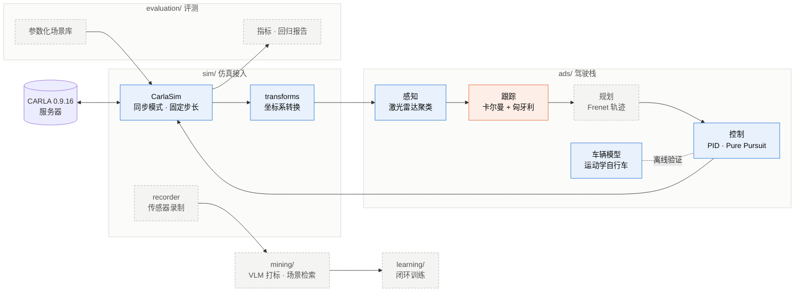

<div align="center">

# highway-sim-eval

**从零手写的驾驶系统，放进 CARLA 闭环仿真，上面再搭一层评测。**

[English](README.md) · **简体中文**

[](https://www.python.org/)
[](https://carla.org/)
[](https://github.com/chasen2041maker/highway-sim-eval/actions/workflows/tests.yml)
[](#路线图)
[](https://chasen2041maker.github.io/highway-sim-eval/)

[动画讲解](https://chasen2041maker.github.io/highway-sim-eval/) · [目前的发现](#目前的发现) · [快速开始](#快速开始) · [路线图](#路线图)

</div>

---

<p align="center">
  
</p>

<p align="center">同一帧激光雷达、4% 的上坡。左：按固定高度切地面，3371 个路面点被当成障碍物；右：先用 RANSAC 拟合出路面，再在它上方 0.2 米切。<a href="https://chasen2041maker.github.io/highway-sim-eval/a5_slope_ground.html">3D 分步动画</a></p>

## 为什么做这个

我是做后端和 AI Agent 的工程师，正在转向自动驾驶。光看资料记不住，所以我自己写一套驾驶系统：一次写一个模块，每个模块都拿仿真器里的真值来对。我一直在问的，也是仿真评测团队每天在问的：指标说车开得好，这个数字能信吗？

这个项目要回答的问题：

- 同一组场景下，哪套驾驶系统更安全、更顺、更高效？
- 它在什么情况下失败，失败前发生了什么？
- 改完以后是真的变好了，还是这次的场景更容易？
- 开环指标（预测轨迹和真值差多少）和真的开起来的表现一致吗？

## 目前的发现

- **先错的是尺子，不是控制器。**用“到最近路点的距离”量偏离车道，路点隔 0.5 米时会藏住最多 0.25 米的误差，所以调参之前先把指标换成了点到线段的距离。
- **积分饱和在 CARLA 里真会出现。**目标 8 m/s，普通 PI 冲到 9.46 m/s；加了防积分饱和降到 8.27 m/s，再把积分系数调大到 0.5，最高 8.11 m/s。
- **“加速度为 0”不等于“踏板为 0”。**把 IDM 的加速度直接当踏板，IDM 要“0”的时候车自己就在减速，前车急刹时最小车距 6.26 米；加一层车速 PID 闭环后是 4.91 米，和纯模型的 4.95 米对得上。
- **前车的激光雷达框中心近了 2.30 米。**雷达只看得到车尾，min / max 框就贴在保险杠上，怎么调聚类参数都没用；不过到车尾的距离（12.70 米）是准的。
- **4% 的坡就能让固定高度去地面失效。**前方 5 米以外 3371 个路面点变成障碍物，检测精确率掉到 0.04；用 RANSAC 拟合地面后恢复（见上图）。
- **相邻两帧相减算车速很不靠谱。**每帧距离误差 ±0.2 米、一秒 10 帧，前车车速最多算错 5.5 m/s。同一组数据换成匀速卡尔曼滤波，1 秒以后最多差 0.35 m/s（误差标准差 1.36 → 0.09）。
- **CI 第一天就抓到我。**GitHub Actions 第一次跑就红了：`requirements.txt` 里漏了 scikit-learn，之前只在我自己电脑上能跑。

## 模块一览

| 模块 | 做什么 | 结果 | 状态 |
| --- | --- | --- | --- |
| 车辆模型 | 运动学自行车模型（后轴参考点、转角限幅） | 绕圈直径与 2L / tan δ 一致 | 完成 |
| 纵向控制 | PID 车速控制，带防积分饱和 | CARLA 里目标 8 m/s，最高车速 9.46 → 8.11 m/s | 完成，CARLA 验证 |
| 横向控制 | Pure Pursuit 沿 CARLA 车道路点 | 前视 2 / 5 / 10 m：离车道中心最远 0.27 / 0.32 / 0.82 m | 完成，CARLA 验证 |
| 跟车 | IDM（带接近速度项），经参考车速 + PID 执行 | 前车急刹：CARLA 最小车距 4.91 m，模型 4.95 m | 完成；停车保持在模型中完成 |
| 评测指标 | 点到线段的横向误差 | “到最近路点距离”会藏住最多 0.25 m 误差 | 完成 |
| 激光雷达感知 | 假 32 线雷达上：去地面（高度阈值，坡道用 RANSAC）、DBSCAN、画框 | 前车框偏 2.30 m（只打到车尾）；坡道：假路面点 3371 → 0 | 假雷达上完成 |
| 检测评测 | 按中心距离一对一贪心配对；召回率、精确率、中心误差 | nuScenes 门槛 0.5 / 2 / 4 m：召回 0.40 / 0.60 / 1.00 | 完成 |
| 跟踪 | 由激光雷达距离估前车车速：匀速卡尔曼滤波；接下来匈牙利匹配 + 编号管理 | 车速最大误差 5.55 m/s（相邻两帧相减）→ 0.35 m/s（卡尔曼） | 进行中 |

59 个单元测试，期望值先手算，每次 push 由 GitHub Actions 自动跑。

## 系统架构



蓝色 = 已完成 · 橙色 = 进行中 · 灰色虚线 = 计划中

## 快速开始

**环境**：Python 3.10，CARLA 0.9.16（服务器 + Python 客户端），NVIDIA 显卡显存 8 GB 以上。

```powershell
git clone https://github.com/chasen2041maker/highway-sim-eval.git
cd highway-sim-eval
python -m pip install -r requirements.txt pytest   # 依赖清单（CI 也只装这些）
python -m pip install carla==0.9.16 matplotlib      # 接 CARLA、画图时再装

python -m pytest -q        # 单元测试，纯 Python，不需要启动 CARLA；每次 push 由 GitHub Actions 自动跑
```

**接入 CARLA**：先启动服务器，再在另一个终端运行示例。

```powershell
# 终端 1：CARLA 安装目录下
.\CarlaUE4.exe -quality-level=Low -windowed -ResX=1280 -ResY=720

# 终端 2：项目根目录下
python -m examples.a2_client_demo
```

> 双显卡笔记本加上 `-prefernvidia`，让 CARLA 跑在独显上。同一时间只运行一个 CARLA 实例，否则后启动的会因 2000 端口被占用而退出。

## 使用示例

```python
import carla
from sim.carla_client import CarlaSim
from sim.transforms import carla_to_ours

with CarlaSim(dt_s=0.05) as sim:            # 同步模式，每帧 0.05 s
    ego = sim.spawn_ego()                    # 生成自车，退出时自动销毁
    for _ in range(60):
        ego.apply_control(carla.VehicleControl(throttle=0.5, steer=0.1))
        frame, sim_time_s = sim.tick()       # 帧号 + 仿真时间
        tf = ego.get_transform()
        x, y, heading = carla_to_ours(tf.location.x, tf.location.y, tf.rotation.yaw)

# 离开 with（包括中途抛出异常）：销毁生成的 actor，恢复服务器原有设置
```

## 实验记录

下面每一行都来自 `examples/` 里的脚本，“设置”一栏写明了跑的是什么。

<details>
<summary><b>展开全部实验（CARLA 和纯 Python）</b></summary>

<p align="center">
  
  
</p>

<p align="center">两张图由 <code>python -m scripts.readme_figures</code> 生成，数据来自项目自身的模型与控制器。</p>

| 实验 | 设置 | 结果 |
| --- | --- | --- |
| 自行车模型绕圈 | 10 m/s，前轮转角 0.1 / 0.2 rad | 直径 55.81 / 27.63 m，与 2L / tan δ 一致；车速加倍时直径不变、一圈用时减半 |
| PID 上坡 | 目标 10 m/s，坡道 −0.5 m/s² | 只有 P 稳定在 9.00 m/s（稳态误差 1 m/s）；PI 收敛到 10.00 m/s，最高 10.89 m/s |
| PID 接入 CARLA（防积分饱和） | Model 3，平路，目标 8 m/s，kp 1.0，油门上限 1，8 s | ki 0.2、无防饱和：最高 9.46 m/s，8 s 时 8.27 m/s；加防积分饱和：最高 8.27，8 s 时 7.89；ki 调到 0.5：最高 8.11，8 s 时 7.99。维持 8 m/s 的稳态油门约 0.39 |
| Pure Pursuit 接入 CARLA（沿真实车道） | Town10HD 出生点 0；用地图路点每 0.5 m 取 80 m 车道中心线（路口取第一条分支，为左转）；目标 6 m/s，12 s；Ld = 2 / 5 / 10 m | 离车道中心线最大 0.27 / 0.32 / 0.82 m。Ld 10 更早开始转向（1 s 时前轮 8.1° vs Ld 2 的 6.4°）、转得更缓（最大 11.0° vs 12.8°）、更晚回正，出弯切弯 0.82 m，约 5 s 后回到线上；6 m/s 下 Ld 2 未见摆动。由 steer 与前轮角反推 Model 3 前轮最大转角约 70°。该指标是“到最近路点的距离”，路点间隔 0.5 m 带来约 0.25 m 的分辨率误差，0.27 与 0.32 无法区分；待改为点到线段的横向误差 |
| Pure Pursuit 前视距离 | 直道 40 m → 半径 20 m 左转 90° → 直道 40 m；起点偏离路线 3 m，10 m/s；Ld = 2 / 5 / 15 m | 直道越过路线最远 1.23 / 0.27 / 0 m，弯道最大横向误差 0.08 / 0.16 / 1.13 m：Ld 小则来回摆动，Ld 大则切弯；动画讲解见 `docs/a3_pure_pursuit_animation.html` |
| IDM 跟车 · 前车急刹 | 两车 10 m/s、车距 25 m；前车第 5 s 起以 −5 m/s² 刹停；自车目标 15 m/s，制动上限 −8 m/s² | 只看车距：距前车 15 m 才明显制动，最大减速度 5.96 m/s²，最小车距 4.46 m；加入接近速度项后提前到 20 m，最大减速度 3.69 m/s²，最小车距 4.95 m；均未碰撞。时距改为 0.5 s：有接近速度项仍未碰撞（最小 3.50 m，最大减速度 6.69 m/s²），去掉后制动打满 8 m/s² 仍碰撞 |
| IDM 接入 CARLA · 前车急刹（开环踏板） | 复现上一行场景：Town10HD 出生点 80（前方 178 m 直路，`examples/tool_find_straight.py` 筛选），两车 Model 3；前 1 s 两车按剧本保持 10 m/s 后 IDM 接管；前车用 `set_target_velocity` 按剧本以 −5 m/s² 刹停；IDM 加速度直接经 `to_pedals` 作为踏板量 | 未碰撞，最小车距 6.26 / 6.28 m（两次运行）。IDM 输出与手算一致（7.0 s：−0.06 m/s²；去掉接近速度项为 +1.21），但车辆没有按该加速度运动：跟车 10 m/s 时 IDM 输出约 +0.45、实际加速度 ≈ 0（维持车速所需油门）；前车刹停期间 IDM 输出 +0.24 → −0.06，制动踏板最大 0.07，松油门滑行的实际减速度却达 −2.7 m/s²。即“加速度 → 踏板”开环映射有偏差：IDM 的 0 对应油门约 0.45，油门 0 对应约 −2 m/s²；本次偏保守属偶然。单帧极值（IDM 最大减速需求）两次运行为 −0.57 / −0.10，不宜直接作指标 |
| IDM 接入 CARLA · 前车急刹（下层速度闭环） | 同上一行场景；IDM 加速度先积分成参考车速（`shadow += a·dt`），再由 PID（kp 1.0，ki 0.5，u_max 1.0）跟踪参考车速并输出踏板；`CLOSED_LOOP` 开关可切回开环 | 未碰撞，最小车距 4.91 m，IDM 最大减速需求 −3.65 m/s²，与纯模型（4.95 m、−3.69）基本一致；前车刹停期间实际减速度 −0.37 → −3.32 跟随 IDM 输出（−1.04 → −3.63），约滞后 0.5 s；跟车 10 m/s 时 PID 的积分项自行找到约 0.43 的稳态油门，制动踏板最大 0.40（开环时 0.07）。低速（< 3 m/s）接近停车时油门 1.0 与制动 0.40 交替、出现顿挫（车速 0.42 ↔ 1.72），实际减速度单帧极值 −4.62 m/s² 来自这段顿挫而非紧急制动段（−3.32）；待加停车保持逻辑 |
| 三样合起来 · 弯道跟车（纯模型预演） | 直道 40 m → 半径 20 m 左转 90° → 直道，路点间隔 0.5 m；两车 10 m/s、车距 25 m，前车第 3 s 进弯时以 −5 m/s² 刹停在弯内；自车 IDM（目标 15 m/s）+ Pure Pursuit（Ld 5 m）+ 自行车模型；对比“IDM 加速度直接执行”与“参考车速 + PID（ki 0.5，加速度上限 3 m/s²）”；横向误差用点到折线距离（`evaluation/metrics.py`）；`examples/a8_model_drive.py` | 直接执行：最小车距 4.96 m，最大减速度 3.28 m/s²。PID kp 1.0：最小车距 4.36 m，最大减速度 4.46 m/s²——前车制动后 3.5–5 s 实际减速度每一时刻都小于 IDM 需求（4.0 s：−1.73 vs −2.98），与参考车速的差距累积，5.5 s IDM 已放松到 −2.89 时仍以 −4.42 补刹（参考车速 2.46 m/s，实际 4.83 m/s）；kp 3.0：4.97 m、3.51 m/s²，与直接执行一致。离车道中心最远 0.09–0.10 m（制动使过弯车速降低）。说明下层控制的滞后会改变闭环安全指标，只在模型里评测规划器不够。动画：`docs/a8_brake_lag.html` |
| 停车保持（纯模型） | 同上一行弯道场景，PID kp 1.0；`ads/planning.py` 的 `StopHold`：我 < 1.0 m/s、前车 < 0.5 m/s、车距 < 8 m 时进入（踩住刹车、PID 积分清零、参考车速置 0），前车 > 1.0 m/s 或车距 > 11 m 时退出（进入 / 退出门槛不同，即迟滞）；5 个单元测试 | 不加：低速时 IDM 为把车距从约 7.6 m 收到 5 m 而再次加速，车速 0.59 → 1.69 → 0 m/s（停下后又起步 1 次），最后停在 4.36 m；加上：7.2 s 进入保持，又起步 0 次，停在 7.61 m。CARLA 中（10-17）同一现象表现为低速油门 1.0 与制动 0.4 交替，待回家验证。动画：`docs/stop_hold.html` |
| 激光雷达去地面（假雷达，纯 Python） | `sim/fake_lidar.py`：numpy 光线求交模拟 32 线雷达（+10° ～ −30°，水平每 0.4°，量程 50 m，测距噪声 σ 2 cm），雷达离地 1.8 m，场景 5 个盒子（同车道前车 15 m、左车道车、路边停车、行人、后车）；`ads/perception.py` 的 `remove_ground` 按高度阈值去地面；`examples/a5_fake_scan.py`、`examples/a5_remove_ground.py`；3 个单元测试 | 一圈 28 800 束 → 19 897 点：地面 19 164（96.3%）、物体 733；22 根下倾激光落地成环（3.1–35.5 m，其中 17 环在 10.9 m 以内）；本车道前车 17.3 m 以外地面 0 点（遮挡：越过车顶的激光约 104 m 外才落地，超出量程）。阈值 z > −1.6 m（离地 0.20 m）：地面残留 0，物体保留 650 / 733（底部 0.2 m 被一起切掉）；阈值 −1.79 m（离地 0.01 m）：测距噪声使 1 069 个地面点漏过，物体保留 725。动画：`docs/a5_lidar_scan.html`（扫描、遮挡）、`docs/a5_lidar_mounting.html`（量产车与 Robotaxi 的雷达安装位置） |
| 激光雷达聚类（DBSCAN，纯 Python） | 接上一行，去地面后 650 点，俯视 (x, y) 用 `ads/perception.py` 的 `cluster_points`（sklearn DBSCAN），min_samples 5；`examples/a5_cluster.py` 按真值统计每个物体被分进几簇；5 个单元测试 | eps 0.5 m：8 簇——后车被切成 2 簇（车头面与车顶之间 0.86 m 无点：第 10 根激光擦过车头上沿，10.67 m 处才落到车顶），路边停车 3 簇；eps 1.0 m：正好 5 簇，左车道远车 4 点为噪声；eps 5.0 m：4 簇——前车与路边停车（最近 3.62 m）粘成 1 簇，簇中心 (8.8, −2.9) 落在两车之间空地。eps 须大于物体内最大缝隙、小于物体间最小距离（本场景约 1.0–3.5 m）。动画：`docs/a5_dbscan.html`（核心点、扩张、噪声）、`docs/a5_roof_gap.html`（车顶缝隙成因） |
| 激光雷达画框（轴对齐框，纯 Python） | 接上一行，eps 1.0 m 的 5 簇，`ads/perception.py` 的 `cluster_to_box` 每簇取 x、y 最小 / 最大值 → 中心 + 长宽；`examples/a5_box.py` 对照真值打印中心误差、画俯视图；2 个单元测试 | 中心误差：行人 0.02 m、路边停车 0.31 m（斜前方，可见车尾 + 侧面，L 形）、后车 1.83 m、同车道前车 2.30 m、左车道车 2.30 m。前车只被打到车尾一面（105 点，框长 0.08 m）：车顶仅低于雷达 0.3 m，落到车顶需下倾 0.99°–1.35°，而相邻激光间隔 1.29°（−0.32° 越过车顶、−1.61° 打在车尾 1.44 m 高），车顶 0 点；min / max 框中心落在车尾，偏向雷达半个车长（4.6 / 2 = 2.3 m）。到车尾的纵向距离（12.70 m）仍准确，偏的是中心。动画：`docs/a5_cluster_box.html`（一簇点 → 框）、`docs/a5_box_offset.html`（侧视车顶缝、俯视 I 形 / L 形） |
| 激光雷达检测评测（纯 Python） | 接上一行的 5 个框；`evaluation/metrics.py` 的 `detection_metrics`：框中心与真值中心两两算距离，每次取全场最近的一对、超过门槛即停、一对一（贪心配对，框没有置信度）；`examples/a5_eval.py` 按 nuScenes 的四档中心距离门槛 0.5 / 1 / 2 / 4 m 计算；7 个单元测试 | 门槛 0.5 / 1 m：配上 2 对（行人、路边停车），召回率 = 精确率 = 0.40，平均中心误差 0.17 m；2 m：加上后车，0.60 / 0.60、0.72 m；4 m：5 对全部配上，1.00 / 1.00、1.35 m。前车与左车道车只被打到车尾（中心偏 2.30 m），2 m 门槛下同一个框同时计一次漏检和一次误报。门槛决定“偏多远仍算检测到”，单一门槛不能同时反映找没找到和准不准，所以按多档平均。动画：`docs/a5_match.html`（配对规则、门槛）、`docs/a5_rear_face.html`（前车只剩车尾，与 eps 无关） |
| 坡道上去地面（RANSAC，纯 Python） | `sim/fake_lidar.py` 设 `ground_slope = 0.04`（上坡 4%：路面 z = −1.8 + 0.04·x）；`examples/a5_slope.py` 对比按高度一刀切（`remove_ground`，z > −1.6）与 RANSAC 拟合地面平面（每次随机抽 3 点定平面，数离平面 < 0.15 m 的内点，抽 50 次取内点最多者；离平面 > 0.2 m 才算障碍物） | 一刀切：路面在前方 5 m（0.20 / 0.04）处高过门槛，19 314 个路面点中 3 371 个被当成障碍物，DBSCAN 24 簇，2 m 门槛召回 0.20、精确 0.04（平地 0.60 / 0.60），相当于前方 5 m 一堵“墙”（幽灵刹车）。RANSAC：最优平面 z = −1.78 + 0.041·x（19 350 内点；含车顶点的候选仅 924，三点相距过近的候选 11 808），路面残留 0，5 簇，召回 / 精确 0.60 / 0.60。对比：所有点做最小二乘偏 3 cm、物体点少保留 22 个（本帧路面占 96%；非地面点多时会被拽偏）。动画：`docs/a5_slope_ground.html`（3D 分步 + 侧视 RANSAC 慢放） |
| 由距离算车速（纯 Python） | 我 20 m/s、前车 18 m/s，前车车尾初始在前方 20 m；每帧量一次距离，10 Hz，测距噪声 σ 0.2 m，5 s；`ads/tracking.py` 的 `diff_speed`：相邻两帧距离差 ÷ 0.1 s；`examples/a6_diff_speed.py`；2 个单元测试 | 真实接近速度 −2.00 m/s。差分算出的速度平均 −1.99，但在 −7.50 到 +3.55 之间乱跳（误差标准差 2.13、最大 5.55 m/s）：÷ 0.1 s 把测距误差放大 10 倍，一帧量偏会把前后两个速度往相反方向带歪 |
| 卡尔曼滤波估前车车速（纯 Python） | 同上一行数据；`ads/tracking.py` 的 `KalmanCV`（状态：距离、速度；`predict` 按当前速度把距离往前推，`update` 按增益 K 合进雷达量到的距离；q = 1，r = 0.04，初始速度 0 ± 5 m/s）；`examples/a6_kalman.py`；5 个单元测试 | 1 秒以后：速度误差标准差 0.09、最大 0.35 m/s（差分 1.36、5.55）。4.0 s 那一帧差分 −7.50 m/s、卡尔曼 −1.97。K（这一帧量到的距离信几成）前 10 帧 0.97 → 0.59 → 0.36，最后稳定在 0.27；速度从 0 出发，约 0.4 s 到 −2。动画：`docs/a6_kalman.html` |
| 坐标转换（CARLA 实车） | Model 3，油门 0.5，steer 0.1，3 s | CARLA：y 24.49 → 26.49，yaw 0.98° → 19.77°；转换后：y −24.49 → −26.49，航向 −0.017 → −0.345 rad，与手算一致 |
| 同步模式可复现性 | 同一脚本重复运行；`CarlaSim` 重构前后 | 位置、航向、车速逐位相同 |
| 车型差异 | 同一控制输入，Model 3 vs CarlaCola 卡车 | 3 s 末车速 5.95 vs 1.44 m/s；每行驶 1 m 航向变化均约 0.04 rad，转弯半径与车速无关 |
| 异步 vs 同步 | 服务器空转 | 异步：现实 1 s 推进约 238 帧；同步：不调用 `tick()` 帧号不变 |

CARLA 实验环境：CARLA 0.9.16，Town10HD_Opt，Windows，RTX 4080 Laptop。

</details>

## 坐标与单位约定

项目内部统一使用车辆右手系（ISO 8855 / ROS REP 103），与 CARLA 交互时在 `sim/transforms.py` 一处转换。

| | 本项目 | CARLA（Unreal Engine 4） |
| --- | --- | --- |
| x | 向前 | 向前 |
| y | **向左** | **向右** |
| z | 向上 | 向上 |
| 航向角 | 弧度，左转为正 | 度，右转为正 |
| 转换 | — | x 不变；y 取反；航向取反并换算单位 |

时间统一用仿真时间（秒）和帧号；每个模块在文档字符串里写明输入、输出、单位和坐标系。

## 目录结构

```text
highway-sim-eval/
├─ ads/              驾驶栈：车辆模型、控制、IDM 跟车、激光雷达感知、跟踪（进行中；变道规划待加入）
├─ sim/              CARLA 连接与同步主循环、坐标转换、假激光雷达（传感器录制待加入）
├─ evaluation/       指标：横向误差、检测评测（召回率 / 精确率 / 中心误差）
├─ examples/         可直接运行的实验脚本
├─ scripts/          工具脚本（README 配图等）
├─ tests/            单元测试（GitHub Actions 每次 push 自动跑）
└─ docs/            动画讲解（浏览器打开）；images/ 为 README 配图
```

后续按功能逐步加入：`scenarios/` 参数化场景库 · `evaluation/` 批量调度与指标 · `dashboard/` 网页看板 · `mining/` 数据挖掘 · `learning/` 闭环训练 · `cpp/` C++ 跟踪器 · `ros2/` ROS 2 发布与录包。

## 路线图

| 阶段 | 目标 | 可展示的成果 | 状态 |
| --- | --- | --- | --- |
| **A** 驾驶栈打通 | 在 CARLA 城市道路里自己开起来 | 激光雷达检测 + 多目标跟踪 + 变道超车演示视频 | 🚧 进行中 |
| **B** 评测与数据闭环 | 批量场景闭环评测 | 几十种场景自动打分、失败回放、版本对比看板 | 📋 |
| **C** 多模态数据挖掘 | 用视觉语言模型理解场景 | 自动打标、一句话检索场景、失败归因，并给出准确率 | 📋 |
| **D** 闭环学习 | 采数据 → 训练 → 评测 → 补数据 | 小型端到端模型的迭代前后指标对比 | 📋 |
| **E** 工程化 | 性能与部署 | C++ 跟踪器、ROS 2 录包、Docker 评测客户端 | 📋 |

<details>
<summary><b>详细清单</b></summary>

**A. 模块化驾驶系统**

- [x] 车辆运动学模型（自行车模型）
- [x] 坐标系转换（CARLA ↔ 车辆右手系），CARLA 实车验证
- [x] CARLA 同步模式主循环（`CarlaSim`）
- [ ] 传感器录制：相机、激光雷达、GNSS、IMU，带帧号与时间戳
- [x] Pure Pursuit 横向控制（模型上验证，前视距离对比实验）
- [x] PID 速度控制接入 CARLA（防积分饱和）
- [x] Pure Pursuit 接入 CARLA（沿地图车道中心线，前视距离对比）
- [ ] 交通流与跟车（IDM 已接入 CARLA 跟剧本前车，下层速度闭环完成；停车保持纯模型完成、接入 CARLA 待做；交通流待做）
- [x] 激光雷达感知（假雷达）：去地面（高度阈值；坡道用 RANSAC 拟合地面）+ 聚类（DBSCAN）+ 框 + 检测评测；换 CARLA 雷达待做
- [ ] 多目标跟踪：卡尔曼滤波 + 匈牙利匹配 + 航迹管理（进行中：单目标卡尔曼已做，接下来匹配和航迹管理）
- [ ] Frenet 坐标 + 多项式轨迹：变道与超车
- [ ] 全链打通：感知结果替换真值，俯视图回放

**B. 仿真评测与数据闭环**

- [ ] 参数化场景库：邻车加塞、前车急刹、慢车挡路、行人横穿
- [ ] 批量调度：任务队列、超时、失败重试、结果入库
- [ ] 录制与回灌：回放记录数据，对感知和规划做回归
- [ ] 指标：碰撞、TTC、舒适度、路线完成度、驾驶分；置信区间；调参与测试场景分开
- [ ] 回归报告与看板：版本对比

**C. 多模态数据挖掘**

- [ ] 视觉语言模型自动打标，并与仿真真值对比准确率
- [ ] 自然语言检索场景
- [ ] 失败归因与场景生成（指标一律由程序计算，模型只负责分类、说明和生成参数）

**D. 闭环学习**

- [ ] 用 A 的系统批量采集示范数据
- [ ] 训练小模型：俯视图 / 目标列表 → 未来路径与速度
- [ ] 闭环评测，对比开环误差与闭环表现
- [ ] 挖出失败场景，针对性补数据再训练

**E. 工程**

- [x] GitHub Actions：每次 push 跑全部单元测试（Python 3.10，依赖固定在 `requirements.txt`）
- [ ] C++ 实现的卡尔曼跟踪器（带单元测试，Python 绑定）
- [ ] ROS 2 话题发布与 bag 录制
- [ ] Docker 化的评测客户端

</details>

## 做法

- **接口写清楚**：每个函数写明输入、输出、单位、坐标系和时间。
- **对照真值**：每个模块都和仿真真值比，给出误差。
- **可复现**：同步模式、固定步长、固定场景和随机种子，同样的输入得到同样的结果。
- **指标只从记录算**：评测指标一律从运行记录里算，不靠肉眼判断。
- **用完收拾干净**：仿真里生成的车和服务器设置，正常结束或中途报错都会回收、还原。

## 参考

- [CARLA Simulator](https://carla.org/) · [CARLA 0.9.16 文档](https://carla.readthedocs.io/en/0.9.16/)
- [HighwayEnv](https://github.com/Farama-Foundation/HighwayEnv)：早期原型（`sim_env.py`、`check_env.py`）所用的二维高速公路环境
